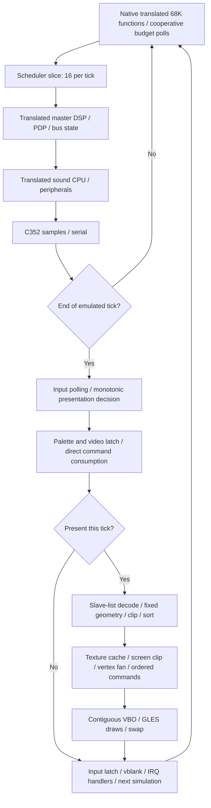

# ARM64 / GLES2 performance architecture audit

Audit date: 2026-10-12. Branch: `feature/knulli-h700`, base `f3d836d`.
Target: RG40XX H, H700 Cortex-A53, Mali-G31, Knulli Scarab / Linux 4.9.170.
This change contains optional diagnostic instrumentation and tools, **no production
optimisation, changed clock rate, scheduler policy, game code, or threading**.

## Executive assessment

The present bottleneck is the **serial main-thread combination of simulation,
geometry preparation and texture-dependent GLES draw submission**. The Mali GPU
has meaningful headroom at 640×480: halving viewport area halves measured GPU
elapsed time but changes FPS only ~2%. VBO streaming is efficient; redundant binds
alone do not explain the slowdown. Simulation is now ~10 ms/tick; city presentation
adds ~18 ms of main-thread CPU work whenever selected. Consequently the scheduler
can nearly maintain simulation speed only by skipping most city presentations.

Repeated uninstrumented medians: **city 58.590 simulation Hz / 23.553 rendered FPS;
race 59.549 Hz / 43.615 FPS**. The long race is not a sustained dense-racing test:
its tail displays very close barriers/walls and submits dramatically less geometry.
Neither mean establishes full-speed rendering across gameplay.

Ranked architectural directions: (1) bounded texture co-residency to combine
**adjacent ordered draws**, (2) compact render records/sorted indices and omission
of unused geometry passes, (3) snapshot-based simulation/presentation concurrency.
The first implementation experiment should be a bounded ordered-batching prototype
on a captured city scene, with a co-residency trace and exact same-GPU image checks.
Do not enable the existing desktop atlas: it budgets 448 MiB and CPU shadows and
uses desktop row-stride uploads. No recommended change is implemented in this audit.

**Core simulation already has the CPU budget for full speed; the remaining
wall-clock loss requires reducing or isolating presentation bursts. Full-speed
city rendering is plausible only with significant architectural work and remains
unproven. A consistent 59.904 FPS throughout gameplay is uncertain**, especially
once omitted HUD/effects/audio output are restored. The evidence does not support
promising 60 FPS or declaring the H700 incapable of it.

## Reproducible configuration and measurement rules

All measured executables explicitly enable the previously validated optimisations:
WRAM reads, split stackless reader and inactive C352 voices. Source defaults are
still OFF. Runtime uses independent timing, skipped-frame geometry ON, 64 MiB
texture budget and frame VBO streaming. No decoded-texture cache or atlas is added.
The existing working `rr_gles2` is preserved; audit executables have separate names.

```sh
SDK="$HOME/dev/knulli-scarab/output/h700/host"
for variant in plain profile; do
 audit=OFF
 [ "$variant" != profile ] || audit=ON
 cmake -S raverace -B "/tmp/rr-audit-$variant" -G Ninja \
  -DCMAKE_TOOLCHAIN_FILE="$PWD/raverace/cmake/knulli-aarch64.cmake" \
  -DKNULLI_HOST="$SDK" -DCMAKE_BUILD_TYPE=Release -DRR_GLES2=ON \
  -DRR_FAST_MEMORY_READS=ON -DRR_SPLIT_MEMORY_READER=ON \
  -DRR_C352_INACTIVE_FASTPATH=ON -DRR_C352_VOICE_COUNTERS=OFF \
  -DRR_MEMORY_READ_COUNTERS=OFF -DRR_PIPELINE_AUDIT="$audit"
 cmake --build "/tmp/rr-audit-$variant" -j2
done
file /tmp/rr-audit-plain/rr_gles2
"$SDK/bin/aarch64-buildroot-linux-gnu-readelf" -d /tmp/rr-audit-plain/rr_gles2
```

To build natively omit the toolchain and SDK options. Native validation uses
`SDL_VIDEODRIVER=offscreen MESA_GLES_VERSION_OVERRIDE=2.0` (Mesa software GLES).
Native timings are not predictions for the handheld.

Deploy without overwriting the working executable:

```sh
scp /tmp/rr-audit-plain/rr_gles2 \
 root@192.168.1.69:/userdata/roms/ports/rave-gles2/rr_gles2-audit-plain
scp /tmp/rr-audit-profile/rr_gles2 \
 root@192.168.1.69:/userdata/roms/ports/rave-gles2/rr_gles2-audit-profile
scp raverace/tools/RaveRacer-Architecture-Audit.sh \
 raverace/tools/audit_system_monitor.py raverace/tools/test_architecture_audit.py \
 raverace/tools/test_headless.py root@192.168.1.69:/userdata/roms/ports/
ssh root@192.168.1.69 '
 set -e
 chmod +x /userdata/roms/ports/RaveRacer-Architecture-Audit.sh \
   /userdata/roms/ports/rave-gles2/rr_gles2-audit-*
 trap "/etc/init.d/S31emulationstation start" EXIT
 /etc/init.d/S31emulationstation stop
 /userdata/roms/ports/RaveRacer-Architecture-Audit.sh
'
# Fetch the printed architecture-audit-* directory, then:
python3 raverace/tools/analyse_architecture_audit.py /path/to/results
```

The runner performs three alternating plain/coarse-profile pairs per workload,
two runs of each diagnostic, and one separate expensive detailed run. Headlines
use plain executables: no audit CSV, PMU, timer queries, sampling, or monitor.
Existing aggregated wall-clock renderer timers remain enabled in both variants.
No ROM extraction or recompilation happens between runs. Diagnostics follow the same
emulated frame/input range but independent timing can select different presentation
ticks; their frame-cohort averages are not strict same-image GPU comparisons. Each starts from reset
with `--coin 180 --gas 200 --steer 300:2304 --steer 700:2048`. City is inclusive
1400–1700 (301 ticks); race is 1400–3600 (2201 ticks). Warm-up frames execute but
are excluded from the ranged rates and tables. Ranged resync/lag counters, not
whole-run startup counters, are compared. The runner compares complete final
state JSON, checks exit codes/faults and records binary SHA256 and governors.

Example individual profiled city run, from `/userdata/roms/ports/rave-gles2`:

```sh
SDL_VIDEODRIVER=mali ./rr_gles2-audit-profile extracted \
 --frames 1700 --coin 180 --gas 200 --steer 300:2304 --steer 700:2048 \
 --timing independent --skip-geometry-on-dropped-frames on \
 --texture-budget-mib 64 --vbo-upload frame --profile-from 1400 \
 --simulation-profile-from 1400 --profile-memory --profile-stages \
 --audit-csv city.csv --audit-gpu-timers > city.json 2> city.log
```

### Instrumentation and interpretation

`RR_PIPELINE_AUDIT=OFF` compiles nested backend scopes and diagnostic branches
out. With ON, `--audit-csv PATH --profile-stages` records buffered rows without
per-frame console logging. Monotonic and **main-thread** CPU clocks delimit:
simulation; scene; backend; texture decode; upload API; ordered submission;
VBO API; swap; host pacing. Exclusive children sum to inclusive parents.
Simulation sub-stages retain the existing exclusive scheduler profiler. Additional
thread-CPU counters cover DSP, sound, C352, serial, board, video, palette, direct
polygons, list decode and sort. Scope boundaries do not change execution.

Coarse mode deliberately includes texture lookup in backend and draw calls in
submission: CPU clocks on thousands of tiny calls distorted performance. Existing
`[PROFILE]` wall timers still separate lookup, vertex upload and draw calls.
`--audit-detail` additionally splits lookup and each draw's wall/CPU time; it is
**not a headline performance mode**. Coarse/detail CSV columns differ accordingly;
a zero detailed column in coarse mode means unmeasured, not free work.

PMU cycles/instructions/generic cache misses/branch misses cover the main thread's
user-space work from frame 1400 until reporting, including userspace Mali and
profiling, excluding kernel and other threads. The matching SDK Linux 4.9.170 `arch/arm64/kernel/perf_event.c` maps generic
cache misses to L1D refill for both PMUv3 and A53; this is not LLC/DRAM traffic.
They are aggregate, not per-stage or memory-bandwidth measurements. Enabled/running times are recorded to expose
multiplexing. Native PC samples have no call stacks. Kernel quantisation and signal
delivery can bias samples (syscall CPU cost can appear at a userspace return PC);
there are no sampled kernel stacks; matching ELF and process maps are required.

`--audit-gpu-timers` uses an optional 16-slot EXT elapsed-query ring. Results are
read only after AVAILABLE, disjoint intervals excluded, missing results counted.
**No glFinish, glFlush, synchronous result fetch or GPU wait is introduced.**
Elapsed spans include GPU idle while CPU builds/submits commands: they are not
GPU active time and must not be added to CPU timings. Vendor debug utilisation is
read once per second and corroborated by controlled experiments where possible.

Diagnostics retain simulation and sorted geometry. `--audit-no-draw` suppresses
only draw API calls; CPU geometry, texture cache, bindings, VBO uploads, clear and
swap remain (reported draws/triangles are logical). `--audit-half-resolution`
uses a 320×240 viewport in the existing framebuffer; CPU LOD/geometry unchanged,
full clear/swap unchanged. `--audit-flat-fragment` removes sampling/division/discard;
shader linking can also eliminate UV varyings and changes coverage, so it is not
pure fragment arithmetic isolation. Existing diagnostic colours use original large
batches and bypass texture work; white-batches retains texture preparation and
ordered draw boundaries. Textured-no-rebind omits redundant bindings only.
**These are diagnostic images, not gameplay/rendering changes.**

## Execution architecture



All emulation, sound sample generation, scene extraction, texture decoding and
GL submission run on the same application thread. SDL audio output is disabled
in this GLES2 build, **not sound CPU/chip execution**. Mali creates driver workers;
the GPU executes queued work asynchronously. Clock catch-up preserves every tick
and selectively omits presentation, retaining bounded backlog/resync behaviour.

The 68K code is statically translated C, **not an interpreter**. `RR_INS` decrements
the instruction budget and records PC/instruction counters in this scheduler test
build. Backward branches/calls poll; `rr_tick` services a slice. Sixteen slices
execute main DSP, sound, C352 and serial work. Frame edges latch vblank and deliver
translated interrupt handlers, with IRQ work charged separately from main 68K.
Target wall frequency is `(25.6 MHz)/(814×525) = 59.904059904 Hz` (16.69336 ms).
Existing emulated instruction/DSP/sample budgets are retained exactly; the audit
does not change their historical rounded constants (83,000 instruction-budget
parameter, 166,667 DSP-step parameter divided into 16 slices, sound/sample divisor
59,906×16). These are existing approximations, not newly claimed cycle-exact clocks.

PDP display-list generation and RAM/bus writes occur during DSP execution. The
scene front end latches `pdp_frame`, render-refresh and slave-active state once
per tick and consumes the accumulated direct commands. These are emulation-visible
and cannot be dropped. Skipped geometry retains this, palette conversion and
cache clock, but returns before direct-polygon expansion, slave-list decode,
projection/clipping/sorting, texture lookup, VBO construction or GL submission.
The next presentation decodes current state; stale geometry is not reused.

## Source and generated-code assessment

### 68K and memory

`gen/rr_lifted.c` contains resumable translated functions with p-code arithmetic,
explicit condition codes, computed control-flow dispatch and `R[]` register state.
Register storage is big-endian byte-addressable, making sub-register writes exact.
Calls to memory helpers are semantic barriers: devices, tracing/checkers, IRQ state
and cooperative suspension can observe writes. Carry/overflow and sign extension
cannot simply be removed or approximated. The compiler folds some fixed-width
expressions into bitfield/extension instructions, but global register updates and
calls prevent broad cross-basic-block register promotion. Profile-guided removal
of dead flag calculations or safe register caching would require translator and
oracle work, not merely handwritten assembly.

Release uses `-O3` for host/engine, **-O1 for translated 68K and sound**, -O2 for
translated DSP. `-fwrapv` and `-fno-strict-aliasing` remain. The matching SDK GCC
13.3 wrapper already selects `-mcpu=cortex-a53 -mtune=cortex-a53` (verified using
`-x c /dev/null -S -Q --help=target`). No LTO/PGO is enabled; NEON is already available without extra target flags. An isolated build-flag
experiment on generated code is worthwhile, but no speedup is measured here and
larger code can worsen instruction-cache pressure. PGO may help hot layout;
whole-ROM blanket inlining or -O3 has uncertain code-size and compile-time costs.

The current WRAM reader is 164 bytes / 41 A64 instructions including alternative
width paths: **no stack allocation, saves, canary or calls on the fast path**.
It validates WRAM/mirror, width, boundary and callback/diagnostic eligibility, then
uses `ldrb`, `ldrh+rev16`, or `ldr+rev`; fallback is a tail branch to protected
original logic. Existing 93–95% coverage and ~1.6 ms/tick saving leave little
function-entry overhead to remove. Do not repeat the previous stack-split experiment.
No new region or write shortcut is proposed here.

The sampled hot `L_4000_at` has a 64-byte frame (saved x19–x23 plus FP/LR),
resumption dispatch and memory helper calls. Unlike WRAM loads, representative
`RG4(0x38)` register reads still compile to four `ldrb` plus shifts/ORs at -O1;
`RS4` commonly writes four bytes. Each translated `RR_INS` also updates PC,
instruction count and global budget. These are concrete generator/runtime costs,
not x86 compatibility shims. A narrow alias-safe register-helper load experiment
and higher optimisation on hot generated units could improve several games, but
neither is benchmarked or changed here. Caching registers/flags across callbacks
or scheduler polls is a substantially higher-risk translator change.


### DSP, fixed geometry and layout

The master C25 is also translated (`rr_c25_exec`); `c71_run` handles interrupts and
already fast-forwards proven halt/spin states. Host `slave_list.c` implements the
slave DSP's display-list rendering job; it is separate from timed master-DSP work.
The walker combines object/view Q15 matrices per instance, reads point ROM/RAM,
transforms vertices, backface-culls, near/guard-clips and emits `geo_quad` records.
`geo_hw.c` preserves fixed-point rounding/saturation with 64- and 128-bit arithmetic.
Projection invokes `__divti3`; that is expensive software wide division on A53,
not a single floating-point divide. Wide operations are necessary in degenerate
clipping cases (source documents prior parity failures with 64-bit arithmetic).
A proven ordinary-range 64-bit path with exact wide fallback is a possible later
experiment; float/NEON approximation is unsafe without differential oracle proof.

Raw four-vertex projection is performed for oracle/metadata fields, then near-clipped
render vertices are projected again. CPU screen clipping adds another pass in the
backend. A concrete unused-work finding: `geo_hw.c` also constructs `q.dv/ndv`
guard-band vertices, but neither Rave Racer's desktop nor GLES2 backend reads
those fields. The consumer found is Prop Cycle's `src/renderer_3d.c`. Rave Racer
GLES2 reads `q.rv` and screen-clips it. A renderer-specific request to omit unused
`dv` construction is plausible and much safer than replacing fixed arithmetic;
its actual cost/frequency is not separately measured, so no speedup is claimed.
This also means existing Rave Racer guard-band visual behaviour must not be
mistaken for the other engine consumer's implementation. Before dropping a pass, establish all raw-field consumers, clipping/UV
bounds and special direct-polygon behaviour. Fixed per-object ROM geometry may be
predecoded into immutable templates, but transformed/view/light/priority state and
point RAM changes are dynamic.

`geo_quad` is large (~1 KiB), containing raw and clipped arrays plus metadata.
`push_quad` copies it; sorting already sorts **12-byte keys**, then applies a
permutation copying complete quads. This is better than sorting large records
with qsort, yet still creates traffic. A sorted index stream/compact render view
could avoid copies without changing the comparator's total order. A matching libc `.text` and virtual-address comparison permits resolving SDK
private symbols against the stripped device library: pooled coarse samples place
**3.83% of city / 3.17% of race main-thread samples** in `__memcpy_generic` during
video preparation, versus ~0.26–0.27% in qsort's merge helper. This supports reducing
large record movement, rather than assuming comparisons dominate sorting. Samples
have no callers, so not every copy can be assigned to permutation: emission and
guard-band scratch also copy. Geometry and
sort buffers grow only on capacity increases; there is no general per-polygon
malloc. Fan expansion duplicates vertices but current upload volumes are small.

### SIMD assessment

Scratch compiler vectorisation reports, using actual build commands without
changing linked objects, confirm existing NEON: geometry UV/state loops, texture
palette/LUT loops and C352 four-output accumulation. C352 assembly uses
`mul v1.4s` / `ssra v2.4s`; this is already integer SIMD. Four-vertex Q15 transforms
remain scalar in this build; wider integer batching could help if rounding and
accumulator behaviour are retained. Branchy clipping, callbacks, gathers and
128-bit division obstruct auto-vectorisation. NEON has no direct replacement for
128-bit divide or arbitrary texture gathers. The evidence supports targeted
integer batching/compact layouts, not an assumed general ARM64 multiplier.

## GLES2 architecture and correctness constraints

The vertex shader performs only screen-to-clip affine conversion. CPU has already
applied original object/view transformations and projection. Perspective UVs are
CPU-generated `u/z,v/z,1/z`; fragment shader divides, samples nearest RGBA and
multiplies vertex colour, discarding alpha zero. Sorted polygon order and tie rules
are retained; depth represents ordered priorities rather than normal eye-space Z.
GLES2 depth buffering is **not** a substitute for original order/transparency rules.
Current port still bypasses HUD/text, gamma/fade/fog and framebuffer effects; audit
conclusions apply to this implemented image, not a future fully faithful renderer.

Textures are decoded from original ROM/tilemap/palette using the shared decoder.
A 65,536-entry hash table (32-probe window) bounds metadata, while RGBA dimensions
bound cached GPU payload to 64 MiB including the white texel. CPU decoded pixels
are discarded after upload; shared scratch is ~4.2 MiB, metadata ~4.46 MiB, no
large atlas shadow. Driver alignment/tiling/mips/metadata can make physical GPU
allocation exceed nominal RGBA accounting; it is not a driver allocator measurement.
Palette generations invalidate relevant entries. Cache eviction policy/capacity
are unchanged. Increasing to 96/128 MiB was already tested and is not repeated.

Consecutive matching texture/scissor geometry combines, but sorted interleaving
of distinct per-texture objects produces numerous small commands. No texture
reordering is permissible. Frame streaming uploads one contiguous vertex prefix
with glBufferData, then draws offsets. Texture mutation drains an ordered prefix
before reuse, preserving queued texels. Previously validated offset-zero stalls
are gone; there is no evidence to replace this with mapping/subdata/rings again.
One program is used; no per-polygon shader switches or postprocessing.

GPU offloading could avoid some host transformations/projection, but original
integer saturation, clipping, painter priorities, non-planar fan interpolation and
UV generation constrain equivalence. GLSL ES1.00 lacks exact wide integer arithmetic.
The physical driver supplies ES3.2 despite requesting ES2, but this audit retains
GLES2/GLSL100; newer APIs are an explicitly separate compatibility project.

## Physical results, CPU/GPU separation and city/race difference

### Uninstrumented headline throughput

Three runs per workload; values are medians with min–max ranges. Counts/lag are
ranged, not startup totals. Both workloads use the same binary/configuration.

| Window | Simulation Hz (range) | Render FPS (range) | Rendered ticks | Skipped ticks | Resyncs | Discarded lag ms |
| --- | --- | --- | --- | --- | --- | --- |
| city | 58.590 (58.533–58.754) | 23.553 (23.335–23.814) | 121 | 180 | 2 | 103.279 |
| race | 59.549 (59.498–59.551) | 43.615 (43.441–43.694) | 1612 | 589 | 5 | 232.692 |

### Measurement overhead

| Window | Plain FPS | Coarse FPS | Coarse change | Detailed FPS (one run) | Detailed change |
| --- | --- | --- | --- | --- | --- |
| city | 23.553 | 21.601 | -8.3% | 15.347 | -34.8% |
| race | 43.615 | 41.394 | -5.1% | 32.324 | -25.9% |

Empty nested wall/thread-CPU scope pair measured **2.836 µs CPU** on the device
(100,000 pairs). Thousands of per-lookup/per-draw pairs are too expensive; that
first diagnostic sequence was stopped and retained separately. Coarse profiling
still changes scheduler decisions and presentation density, so it is not used for
headline FPS. Detailed timing is attribution only. The following distributions
include instrumentation; they are not claimed to be uninstrumented p95 values.

### Simulation pipeline

Exclusive wall stage means averaged over three profiles; percentages use the
corresponding averaged total. Each individual run reconciles stages exactly
(reported residual 0.000000 µs). Table rounding may leave a few microseconds.

| Exclusive stage | City ms/tick | City share | Race ms/tick | Race share |
| --- | --- | --- | --- | --- |
| Main translated 68K, including memory/I/O | 3.982 | 40.0% | 4.070 | 40.2% |
| Master DSP / bus / PDP | 2.296 | 23.0% | 2.343 | 23.1% |
| Sound CPU / peripheral service | 2.141 | 21.5% | 2.189 | 21.6% |
| C352 samples | 1.178 | 11.8% | 1.157 | 11.4% |
| IRQ dispatch + translated handlers | 0.255 | 2.6% | 0.267 | 2.6% |
| Scheduler / accounting | 0.082 | 0.8% | 0.066 | 0.7% |
| Serial | 0.027 | 0.3% | 0.026 | 0.3% |
| Board/frame-edge devices | 0.005 | 0.0% | 0.006 | 0.1% |
| Total | 9.966 | 100% | 10.125 | 100% |

Actual main-thread CPU measurements: DSP ≈2.261/2.307 ms (city/race), sound
≈2.098/2.150, C352 ≈1.153/1.126, serial + board ≈0.031/0.032. Remaining CPU
(68K + IRQ + scheduler + other instrumentation) is obtained by subtracting those
exclusive categories from total CPU, not by adding another inclusive 68K estimate.
IRQ/scheduler sub-splits have wall timings only. IRQ/frame-edge work belongs to
the interval preceding the next screen-preparation boundary; the terminal edge
is outside the last recorded simulation interval, as in the existing profiler.

| Measured distribution | City mean | median | p95 | max | Race mean | median | p95 | max |
| --- | --- | --- | --- | --- | --- | --- | --- | --- |
| Simulation wall / tick | 9.946 | 9.767 | 10.954 | 18.460 | 10.123 | 10.026 | 11.484 | 17.271 |
| Simulation CPU / tick | 9.886 | 9.740 | 10.782 | 16.394 | 10.055 | 9.978 | 11.266 | 16.567 |
| Scene CPU / presented tick | 4.953 | 5.049 | 5.576 | 6.098 | 2.922 | 2.472 | 5.140 | 8.071 |
| Host preparation CPU / presentation¹ | 9.640 | 8.402 | 15.662 | 59.111 | 4.989 | 3.642 | 9.824 | 97.963 |
| Complete presentation CPU² | 17.974 | 16.500 | 27.774 | 83.939 | 8.454 | 6.156 | 17.881 | 130.095 |
| Complete presentation wall² | 18.097 | 16.542 | 28.244 | 87.140 | 8.608 | 6.290 | 17.931 | 130.259 |

Units ms; median of the three per-run statistics, not a pooled percentile.
¹ Scene + backend CPU excluding ordered submission and upload scopes. Includes
initial backend GL state calls, so it is an estimate of host preparation, not
perfect pure-algorithm time. ² Scene + whole backend + swap, **excludes simulation
and pacing**; includes driver client CPU, not GPU worker CPU or GPU elapsed time.
Skipped scene CPU is ~0.23 ms; skipped backend/submission/texture work is zero.
Rendered and skipped simulation cohorts remain separately available in summary.json.
Simulation CPU is ~99% of wall; a low FPS is not primarily sleeping inside 68K code.

### Uninstrumented renderer wall breakdown

Existing aggregate timers, median per-run means, per actual presented frame.
Submission includes vertex + draw + state; do not add its children again.

| Stage wall ms/presentation | City | Race |
| --- | --- | --- |
| Scene / palette / list / fixed geometry / sort | 4.983 | 2.944 |
| Backend clip / fan / command build / setup | 2.183 | 1.016 |
| Texture cache lookup + CPU decode | 2.348 | 1.010 |
| Texture upload API | 0.811 | 0.246 |
| Ordered submission inclusive | 6.912 | 2.936 |
| ↳ VBO upload | 0.195 | 0.079 |
| ↳ glDrawArrays calls | 5.248 | 2.233 |
| SDL/EGL swap | 0.480 | 0.893 |

Native CPU measurements in coarse runs confirm submit is predominantly active
client/kernel CPU: city ~6.75 ms wall versus ~6.70 ms CPU **excluding** VBO; scene
~4.97 versus ~4.95. Swap is ~0.48 wall/CPU city. Race coarse swap averages
~0.45 wall versus ~0.34 CPU, while plain swap averages ~0.89 wall: faster producers
and profiling alter buffering/waiting. No syscall stacks or hardware fence trace
is collected, so exact wait reasons are unresolved. Swap is a secondary cost,
not the multi-millisecond city bottleneck. GPU overlap is already occurring.

| Window | Draws/frame | Triangles/frame | Submitted vertices/frame | Binds/frame | VBO uploads/frame | VBO KiB/frame | Cache hits | Misses | Evictions | Texture uploads |
| --- | --- | --- | --- | --- | --- | --- | --- | --- | --- | --- |
| city | 795.9 | 1910.0 | 5730 | 798.8 | 1.01 | 223.8 | 147979 | 235 | 831 | 235 |
| race | 310.3 | 694.2 | 2083 | 311.9 | 1.00 | 81.3 | 1173546 | 1114 | 2799 | 1114 |

Cache counts span the measured window. GPU payload peaks remain below 67,108,864
bytes including white. GLES evictions delete texture objects; there is no live
unaccounted free-object storage. Reported peak is requested RGBA payload, not
proprietary physical driver memory. CPU metadata 4,456,448 bytes; auxiliary
310,816; scratch 4,202,500; decoded cache/shadow zero. Plain final RSS ≈199.4 MiB
city / 230.4 MiB race, MemAvailable ≈624.2 / 592.8 MiB, CMA free ≈38.6–38.9 MiB.
No allocation failures or memory-pressure indication. VBO traffic is only ~5.1 /
3.5 MiB/s at observed FPS; it is no longer a large transfer/stall bottleneck.
The GPU stream counts duplicated fan vertices; total CPU vertices including culled
packets are not separately counted. Emitted quads imply at least ~4.9k / ~2.9k
raw vertex transforms per presentation, plus rejected packets and clip vertices.

### Controlled diagnostics

Two repeats each except coarse textured baseline (three). All use the same
emulated windows; presentation tick sets can differ. GPU column is median mean
valid elapsed span, **not active utilisation**. Diagnostic images are not faithful.

| Diagnostic | City sim Hz | FPS | GPU span ms | Race sim Hz | FPS | GPU span ms |
| --- | --- | --- | --- | --- | --- | --- |
| Textured coarse | 58.522 | 21.601 | 8.595 | 59.354 | 41.394 | 6.515 |
| 320×240 viewport | 58.375 | 22.012 | 4.338 | 59.438 | 42.249 | 2.863 |
| Flat fragment | 58.574 | 25.103 | 3.647 | 59.599 | 45.234 | 2.584 |
| No draw API | 58.806 | 36.436 | 0.038 | 59.607 | 51.049 | 0.038 |
| White / same batches | 58.642 | 26.399 | 7.212 | 59.510 | 45.977 | 5.966 |
| Textured no-rebind | 58.458 | 21.655 | 8.602 | 59.481 | 41.888 | 6.531 |
| Diagnostic / original large batches | 59.945 | 51.382 | 5.708 | 59.930 | 57.711 | 5.401 |

Halving viewport dimensions changes city FPS ~+1.9% and race ~+2.1% while halving
GPU span. No-draw city FPS improves ~69%, but does not reach 60. Diagnostic large
batches use ~3 draws city and reach ~51 FPS; CPU scene + fan construction remain.
At current frequency the measured city GPU span mean ~8.59 ms, p95 ~9.03 ms,
maximum <9.43 ms; race mean ~6.52, p95 ~9.33, max <10.22. Disjoint rows zero;
query rings never fill. Four of six coarse runs leave one pending query at exit: missing results are not force-waited.

### Representative windows

From race-profile-1 (one reproducible run, not extra unprofiled headlines):

| Emulated frames | Ticks | Presentations | Draws/presentation | Triangles/presentation | Presentation CPU ms |
| --- | --- | --- | --- | --- | --- |
| 1400-1700 | 301 | 113 | 795.6 | 1909.4 | 17.97 |
| 1701-2200 | 500 | 208 | 688.1 | 1533.4 | 16.46 |
| 2201-2700 | 500 | 353 | 254.0 | 543.8 | 8.61 |
| 2701-3200 | 500 | 457 | 212.8 | 461.8 | 6.00 |
| 3201-3600 | 400 | 400 | 114.3 | 260.8 | 4.44 |

City and race **simulation** CPU differ by only ~0.17 ms/tick (~2%), whereas
presentation CPU differs by more than 2×. Draw count (~796 vs ~310), visible
triangles (~1910 vs ~694), list preparation and record sorting drive the difference.
Native equivalent-frame captures at 1700/2200 show road/city geometry; 2700/3200/
3600 show very close barriers/walls and progressively sparse visible geometry.
This establishes a limited-view tail, not normal dense racing; no speed variable
was decoded to prove a stopped vehicle. The established race average masks this.

Keep both benchmarks. Add an input replay staying on-road through dense city and
multiple visible cars; a repeating high-speed lap including new texture regions;
track-selection/scene transitions; and a replay with documented audio activity.
Validate these visually and by geometry counters before treating them as worst-case.
No new representative gameplay replay is invented in this audit. Finite-window
rates slightly above 59.904 in diagnostic runs are boundary/clock phase effects;
the configured target is unchanged.


The city diagnostic controls provide a particularly strong separation: reducing
viewport area 4× cuts GPU elapsed roughly in half while rendering throughput
barely changes. Suppressing draw calls makes the vendor utilisation counter fall
to zero and improves throughput, but CPU geometry/cache work still prevents every
tick being presented. The simpler fragment shader also reduces **client submission
CPU time**, so its benefit cannot be attributed solely to fragment ALU. Texture
state validation/driver work depends on the active shader and texture; white
batches avoid those costs in addition to changing sampling. Redundant binding
elimination alone is within observed variation. This is a mixed pipeline with a
**CPU/driver critical path**, not evidence of a saturated fragment GPU.

A city coarse run's largest preparation outliers were frames 1443 (63 misses;
25.3 ms decode, 16.1 ms upload CPU) and 1546 (110 misses, 394 evictions; 37.0 ms
decode, 15.2 ms upload CPU). These isolated texture bursts matter for p95/resyncs
although average upload frequency is low. Eliminating draw overhead alone will
not fix those spikes. Do not label all misses capacity churn: first appearances,
LOD/UV-key variation and palette generations also invalidate textures.

The backend looks up/bakes a texture **before** final screen clipping. If a
polygon clips away after changing texture, it has already terminated the preceding
batch (`empty_texture_flush`). City has roughly 79 such boundaries per presented
frame. Position-only rejection before lookup, when provably safe, is a smaller
potential follow-up; it does not justify arbitrary texture sorting or bypassing
near/guard clipping. It offers a bounded fraction of the draw fragmentation, not
an established route to 60 FPS.

### GPU-offload candidates

Exact wide fixed projection is a poor initial shader migration target. A more
promising complementary investigation is **indexed texture storage plus a GPU
palette lookup**: the current decoder expands palette indices to RGBA on CPU and
keys baked images by palette generation. GLES2 can sample an index image and a
small nearest-filtered palette image. In principle 8-bit indices reduce nominal
texel payload fourfold and palette changes no longer require redecoding every
RGBA image. Extra dependent sampling, cmodes, solid pens, palette selection,
alpha/guard texels and precision all require correctness experiments; capacity
and FPS gains are not measured here. It should not be bundled into the first
batching experiment. Immutable ROM-template decoding and compact render records
are safer starting points than substituting floating-point DSP arithmetic.


## Parallel processing assessment

One-second telemetry, separately instrumented profiles. SDL's absolute performance
counter is MONOTONIC_RAW (confirmed in the matching SDK SDL disassembly); initial
Python telemetry used MONOTONIC. The post-run RAW−MONOTONIC offset was +0.970032 s.
Saved telemetry is analysed with that approximate offset; contemporaneous offset
changes were not recorded. The monitor now records both domains for future runs.
Stage durations/FPS do not depend on this alignment. Per-window telemetry values
are approximate; whole-run frequency/thermal observations and controlled GPU
query results support the qualitative conclusion. The main application thread consumes
~99% of one core city and ~97% race. It migrates among CPUs, so no individual
physical core shows continuous 100%. Example city core busy percentages:
24.9 / 22.7 / 19.9 / 38.9; race 21.0 / 26.5 / 26.4 / 36.0. These include OS work.
Mali `cmar-backe` consumes ~2.4% / 3.6% of one core; memory-purge <0.4%; utility
workers negligible. No independent application geometry/audio worker exists.
This is measured spare capacity plus a saturated serial thread, not just an
aggregate utilisation inference. Sampling is main-thread-only and misses worker
costs; telemetry includes them.

CPU governor `schedutil`, cap 1.512 GHz; all selected ranged samples are at 1.512 GHz.
Whole-run startup/waiting samples can show lower frequencies. GPU
`simple_ondemand` stays 240 MHz throughout recorded measurements (available
240–696 MHz). Observed CPU temperatures across three coarse runs: roughly
53–57°C, GPU ~52–55°C; no sustained CPU frequency drop indicating thermal
throttling. One-second samples cannot exclude brief changes, and plain runs have
no monitor; adjacent profiles and repeatability constrain that uncertainty.
No governor, frequency, thermal, affinity or system settings were changed.

Vendor GPU utilisation averages ~20% city / ~28–29% race in coarse profiles;
half viewport ~10% city and no-draw zero. This correlates with valid elapsed
queries and presentation rates, supporting GPU headroom. It is a coarse vendor
counter, not a validated fragment/vertex performance-counter breakdown.

PMU runs have equal enabled/running periods (no multiplex loss). Main user-space
IPC ~0.651 city / ~0.655 race, L1D refill ≈2.7 / 2.6 per 1000 instructions, branch
miss ≈8.6 / 8.9 per 1000 instructions. Counts include profiling and userspace
Mali, exclude kernel/other threads. Low IPC with branchy generated/global-state
code is consistent with instruction/dependency/branch costs; these aggregate
counters cannot prove a particular function memory-bound. **DRAM bandwidth,
per-stage stall/cache counters, GPU ALU/tiler/memory counters and fence wait stacks
are not measured.** No `perf` executable is installed; raw perf_event_open succeeds
for four CPU events and existing CPU-triggered sampling is reused (~100 samples/s
wall despite requested 200 Hz). No tools are installed/downloaded.

Pooled coarse samples: ~1514 city / 10556 race main-thread PCs. A representative
race run places 14.5% in userspace Mali, 9.9% in translated master DSP, 6.6% in
C352, 5.8% in `L_4000_at`, 5.4% in `quad_fixed`, 5.3% in stackless `rr_read`,
3.5% in bake implementation, 2.4% in sound peripheral service, and 1.3% in wide
integer division. These are exclusive sampled PCs, **not caller-inclusive costs**;
Mali lacks private debug symbols. Sorting's copy cost is additionally visible in
matched private libc symbols. No single remaining CPU function dominates enough
to explain the city render gap alone.

Before proposing an assembly/SIMD change, separate mixed geometry control flow,
wide arithmetic and record traffic. CPU offloading cannot be justified purely by
triangles being numerous: only ~5.7k submitted city vertices exist, while hundreds
of driver commands are issued. The current priority is reducing per-polygon
host/driver overhead, not a conventional high-poly GPU rewrite.


Simulation/presentation separation is the strongest potential parallel candidate
because optional host geometry is already isolated. Keep PDP, direct consumption,
video handshake and inputs on the simulation owner. A presentation worker must use
immutable snapshots of polygon RAM, direct commands, palette/mixer/view/lighting
and point RAM state; it cannot read mutable `g_rr`/global geometry/cache state while
simulation writes. Use bounded double/triple snapshots (order of MiB, not duplicate
64 MiB textures) and latest-complete-frame selection; GL context/cache stays on one
owner. Simulation determinism, snapshot boundaries and input latency must be tested.
The driver may serialize context work regardless of spare CPU cores.

Parallel C352 is less attractive: sound CPU reads BUSY/register results on following
slices, so each ~1/16-tick mix has a tight dependency. Main DSP writes RAM consumed
by 68K/PDP, so it is not independent work. Texture decoding can stage CPU pixels
asynchronously only with palette generation/version safety, bounded scratch and
ordered upload barriers; few misses limit expected benefit. Parallel geometry
batches require captured per-record view state and deterministic merge/tie ordering,
plus cleanup of global mutable lighting/view/sort state. Extra threads alone do
not remove work and may worsen shared caches/bandwidth/thermal limits.

## Performance budget and realistic upper bounds

Target interval **16.69336 ms**. Approximate critical-path model uses profiled
main-thread CPU means, retaining their quantified overhead. GPU elapsed is shown
separately because it overlaps CPU simulation and includes possible idle gaps.

| Mean budget | City | Race |
| --- | ---: | ---: |
| Simulation CPU per tick | 9.89 ms | 10.05 ms |
| Essential skipped video/palette per tick | ~0.23 ms | ~0.23 ms |
| Presented scene + backend + swap CPU | 17.97 ms | 8.45 ms |
| Hypothetical serial every-tick presentation | ~27.9 ms | ~18.5 ms |
| Reduction of that mean to 16.69 ms | ~40% | ~10% |
| GPU elapsed mean (overlapped; not additive) | 8.59 ms | 6.52 ms |
| Presentation CPU allowed at full simulation | ~6.8 ms | ~6.6 ms |
| Current presentation CPU reduction needed | ~62% | ~22% |

Presentation includes essential palette/latch on that tick: do not add it again
to the every-tick total. Profiling overhead makes these estimates conservative;
use raw unprofiled wall stages as a cross-check (city ~17.7 ms presentation).
Means are not worst-case guarantees. City presentation p95 ~27.8 ms and race
~17.9 ms; rare texture bursts exceed 80/130 ms. Adding unrelated stage p95s is
not a valid overall p95. Unprofiled whole-tick distributions were not recorded.

For a serial thread at simulation rate H:

`maximum presentation rate ≈ [1000 − H×(simulation + essential skipped scene)] /
 (presentation − essential skipped scene)`

This predicts roughly low-20s city and low/mid-40s race after allowing for
profiling, waits and resyncs, consistent with measurements. Saving 0.5 ms per
simulation tick creates only ~30 ms CPU time/s: about 1.7 additional city
presentations/s at current cost, not a leap to 60 FPS.

Amdahl bound: city draw + submission state represent ~6.7 ms of an approximately
28 ms serial every-frame path. Even removing all that work (impossible in practice)
leaves >21 ms, below 48 FPS when coupled and still insufficient for 60 simulated
**and** rendered frames on one thread. Conversely eliminating simulation alone
does not address preparation spikes or original-texture driver fragmentation.

Ideal two-owner pipeline lower bound becomes `max(simulation+snapshot,
presentation CPU, GPU service)`, **not their sum**. With today's means that is
~18 ms city: an optimistic ceiling near 55 FPS before overhead, not a prediction.
Race mean would fit, but its dense opening and texture spikes would not. Combining
render cost reductions with concurrency could fit the target; shared cache/DDR,
thermal load, worker latency and the Mali driver must be measured. Existing GPU
asynchrony does not already parallelise CPU geometry with CPU simulation.


## Ranked architectural opportunities and next experiment

### 1. Bounded texture co-residency / ordered draw coalescing

- **Evidence:** ~796 city commands for ~1910 triangles; submission ~6.9 ms
  inclusive, draw calls ~5.25 ms. Original diagnostic batching ~3 calls. White
  same-boundary rendering still has ~4 ms draw cost. No-rebind alone is ineffective.
- **Change:** reuse decoder and UV-coordinate interface with bounded atlas/pages
  (or equivalent GLES2 co-residency), allowing adjacent sorted primitives with the
  same page/scissor/state to merge. Preserve exact order; do not sort by texture.
  Also inspect texture lookup before offscreen rejection and repeated scissor
  state in command submission.
- **Mechanism:** fewer client validations, state changes, GPU command descriptors
  and draw API entries; potentially fewer allocation calls. GPU sampling work
  largely remains. No entire desktop renderer replacement is needed.
- **Estimate:** no defensible guaranteed gain before a size/key/order packing trace.
  Upper removable submission ceiling ~6.7 ms/city presentation; even achieving
  that alone cannot make the serial path 60 FPS. Optimistically several milliseconds
  are addressable if most adjacent textures co-reside; fragmented multiple pages
  may give little benefit. Atlas packing/wasted space could worsen misses at 64 MiB.
- **Complexity/risk:** medium–high. UV precision, guard texels, nearest clamping,
  palette invalidation, eviction/mutation of queued slots, budget accounting and
  CPU shadow memory are correctness constraints. GLES2 cannot use desktop row stride.
- **Validation:** trace/replay one captured city frame, compare exact pixels on
  each GPU, assert ordered keys/geometry/board/audio hashes and budget; then three
  repeated city/race trials and independent interactive runs. Measure draw reduction,
  client CPU, GPU spans and cache churn, not just FPS.
- **Applicability:** platform-independent rendering change, particularly valuable
  for Mali driver overhead; decoder/UV interface is shared by other System 22 games.

### 2. Compact geometry representation and render-only preparation

- **Evidence:** city scene ~5 ms (list/fixed geometry ~3, sort ~1.8), backend
  clip/fan/state ~2.2; ~1 KiB quads copied on emission and permutation; matched
  video memcpy samples 3–4%, more than sort comparisons. Raw/near projections
  duplicate ordinary cases; guard-band `dv` construction has no Rave Racer consumer.
- **Change:** retain exact source/golden representation for gates, introduce a
  compact render view and sorted index stream, predecode immutable ROM templates
  where proven safe, omit requested unused fields/passes for this backend. Consider
  exact ordinary-range projection with wide fallback or integer batch transforms
  only after measuring their isolated contribution.
- **Mechanism:** fewer large copies/cache lines, repeated packet decode/projection
  and temporary records; NEON becomes easier once input layout is regular.
- **Estimate:** total scene+build ~7.2 ms is an impossible all-work-elimination
  ceiling. Copy samples imply order ~1–2 ms per city presentation spent in all video
  memcpy, but not all are removable permutation copies; wide division ~1.3% of
  whole race samples is a smaller ceiling. No measured NEON speedup is claimed.
  Unused guard work's frequency/cost requires a separate counter before estimating.
- **Complexity/risk:** medium for index iteration/compact view, high for wide
  arithmetic or template reuse. Preserve reverse-emission tie ordering, view/light
  transitions, dynamic point RAM, clipped attribute rounding and direct polygons.
  A float transform rewrite is not justified.
- **Validation:** differential geometry gate + exact same-GPU captures at dense
  and near-degenerate/transition frames, board/video/audio hashes; time list/sort,
  copies and build separately; verify both desktop/GLES2 consumers.
- **Applicability:** mostly shared engine / platform-independent; exact NEON
  transform batching is ARM64-specific and could benefit other System 22 ports.

### 3. Snapshot-based simulation / presentation ownership

- **Evidence:** main thread near one-core saturation while driver workers are
  small and other cores have spare capacity; hardware simulation ~10 ms fits
  16.69 ms, but a presentation adds ~18 ms city and occasional >80 ms bursts.
  Skipped geometry already demonstrates separation from hardware bookkeeping.
- **Change:** retain all hardware/PDP/direct consumption on simulation owner;
  publish bounded immutable video snapshots to a graphics owner. Keep cache and
  GL context on one owner. Pump SDL events on the window owner and communicate
  latched input safely; test Mali context transfer, never concurrent context calls.
  No live mutable g_rr/engine state may be accessed by both owners.
- **Mechanism:** overlap CPU emulation with CPU preparation/submission, isolate
  texture/driver stalls from simulation/input. GPU already overlaps independently.
- **Estimate:** ideal city critical path ~18 ms instead of ~28 (~55 FPS ceiling),
  not a claimed attainable result. Rendering reductions remain necessary. Extra
  snapshot copies, shared caches/bandwidth and thermal limits can erase gains.
- **Complexity/risk:** high. Snapshot completeness, direct polygons, palette/cache
  clocks, point RAM, view globals, deterministic order, stale-frame selection,
  input edges, shutdown/context ownership and frame latency must be proved.
  Bounded few-MiB snapshots are plausible; duplicating texture caches is unnecessary.
- **Validation:** first replay snapshots synchronously and verify byte-equivalent
  geometry/images/state before adding a worker; then independent timing, input,
  PCM/board digests, per-thread CPU, lag and long thermal tests.
- **Applicability:** platform-independent multicore architecture, H700 benefits
  from spare cores; shared System 22 front ends may reuse the ownership boundary.

### Recommended next implementation experiment

**Choose opportunity 1 first:** capture the ordered texture-key/dimension/scissor
trace for city, estimate bounded page co-residency, then prototype original-texture
ordered batching for a captured scene without changing the live cache policy.
Keep the 64 MiB budget explicit and CPU upload scratch bounded. If packing cannot
meaningfully reduce adjacent breaks, stop that prototype and prioritise compact
index-based geometry; do not expand the atlas capacity speculatively. Separately,
omitting unused guard-band output is a small correctness-testable component of
opportunity 2, not a claim of a large gain. No prototype is implemented here.

| Goal | Assessment |
| --- | --- |
| Full-speed simulation | Core tick capacity already sufficient; sustaining the target during interactive presentation requires reducing or isolating render/texture bursts. More simulation micro-optimisation alone will not guarantee it. |
| Sparse race-tail 59.904 rendering | Already every tick is presented in measured 3201–3600 subrange; not proof for dense racing. |
| Mean race rendering at 59.904 | Plausible with targeted architectural work; ~10% mean serial-path reduction, but dense opening still needs city solution. |
| Dense city 59.904 rendering | Significant architectural work; batching alone insufficient. Combine reduced host preparation with co-residency and/or proven concurrency. |
| Sustained 59.904 across gameplay | Uncertain pending representative replays, tail-latency work and the architecture experiments; not guaranteed by current GPU headroom. |

Further stackless-reader/C352 micro-optimisations are lower impact for rendered
FPS. Sound event-deadline caching is still a legitimate simulation experiment
(~2.4% of overall samples in peripheral service), but cannot remove the city
presentation critical path. Reprofile after architectural changes; do not weaken
stack protection, use fast-math, alter emulated budgets or increase clock rates.


## Correctness, available metrics and artifacts

- Native desktop `rr` rebuild passed; GLES2 native and SDK ARM64 builds passed.
  `file/readelf` confirm AArch64 Linux 4.9 ABI, loader `/lib/ld-linux-aarch64.so.1`;
  direct dependencies SDL2, GLESv2, EGL, Mali, libm/libc/loader, **no desktop libGL**.
- Existing native headless and optional simulation off/stages/sampling regression
  passed (state, pixels, distributions and reconciliation).
- New `tools/test_architecture_audit.py`: native **and physical ARM64** baseline
  versus coarse/query instrumentation at 600/1700/3600 with fixed every-third-tick
  presentation. Final JSON matches real headless reference; same-platform PPM
  captures are byte-identical; four-channel PCM/chip, board and video digests
  identical; nested CPU/wall totals reconcile. All generated samples since reset
  are covered (3600: 5,128,033 samples / 57,600 intervals).
- Detailed versus plain/coarse frame-600 Mali and native captures/state also match.
  Cross-Mesa/Mali pixels are **not** byte-identical (different rasterisation/precision);
  cross-platform JSON and audio digests match. Correctness checks do not relax
  same-GPU equality to accept differences.
- All **38** completed hardware benchmark runs exit 0, all 19 JSON states per
  workload identical. Board hashes city `6375e251`, race `b93b4e5a`; video tick
  digests city `9d3d73f76d1ba139`, race `ef5caaff82673995`; 1700/3600 ticks,
  9094/26194 direct commands consumed in all modes. No traps, unmapped accesses,
  ROM writes, DSP/sound faults, shader/GL or allocation errors. Cache payload ≤64 MiB.
- ARM64 existing headless regression passed; controller and normal rendering
  implementation unchanged. Working executable SHA check passes; EmulationStation
  restored and process existence checked after tests. No system settings modified.

Artifacts: device `/userdata/roms/ports/rave-gles2/architecture-audit-20261012-165108-31214/`;
local `/tmp/rr-architecture-results/architecture-audit-20261012-165108-31214/` with
logs, CSV, query CSV, telemetry, native PCs/maps, state JSON/SHA, summary.json and
comparison.tsv. Native correctness `/tmp/rr-audit-validation/`; physical correctness
`/userdata/roms/ports/rave-gles2/audit-correctness/` (copied locally under
`/tmp/rr-architecture-results/audit-correctness/`). Assembly/vector reports
`/tmp/rr-audit-assembly/`. The interrupted expensive first sequence is retained
separately; it is not mixed into the repeated baseline tables.

Matching audit ELF SHA256:

- plain `290c0d4a04cb1d3b6ba2abd1c4aa1802c5a1bb361d290f8190f51fb2e4be1656`
- profile `6743abad922c82f6fcb9dfee0d75ba18e787434f8c66d5d42e21942edd04752e`

Reproduce analysis and symbolisation:

```sh
RESULTS=/path/to/architecture-audit-20261012-165108-31214
python3 raverace/tools/analyse_architecture_audit.py "$RESULTS"
python3 raverace/tools/analyse_simulation_samples.py \
 /path/to/matching/rr_gles2-audit-profile "$RESULTS/race-profile-1-samples.tsv" \
 "$SDK/bin/aarch64-buildroot-linux-gnu-nm" \
 "$SDK/bin/aarch64-buildroot-linux-gnu-addr2line" 3600
# Optional libc private symbols: fetch device libc, then require identical .text:
scp root@192.168.1.69:/lib/libc.so.6 "$RESULTS/libc-device.so.6"
python3 raverace/tools/analyse_architecture_audit.py "$RESULTS" \
 "$SDK/aarch64-buildroot-linux-gnu/sysroot/lib/libc.so.6"
"$SDK/bin/aarch64-buildroot-linux-gnu-objdump" -d \
 --disassemble=L_4000_at /path/to/matching/rr_gles2-audit-profile
"$SDK/bin/aarch64-buildroot-linux-gnu-objdump" -d \
 --disassemble=quad_fixed /path/to/matching/rr_gles2-audit-profile
# Scratch vector report: take exact Ninja compile command, change -o to /tmp,
# add -fopt-info-vec-all=/tmp/geo_hw.vec.txt. Do not link scratch objects.
ninja -C /path/to/build -t commands rr_gles2
```

Reproduce correctness separately from performance, using all enabled optimisation
flags and an existing matching headless build (no GUI/server overlap):

```sh
SDL_VIDEODRIVER=offscreen MESA_GLES_VERSION_OVERRIDE=2.0 \
 python3 raverace/tools/test_architecture_audit.py \
 /path/to/native/plain/rr_gles2 /path/to/native/audit/rr_gles2 \
 /path/to/native/rr_headless raverace/extracted /tmp/rr-audit-correctness
# On device, with EmulationStation stopped and EXIT trap restoring it:
cd /userdata/roms/ports/rave-gles2
SDL_VIDEODRIVER=mali python3 /userdata/roms/ports/test_architecture_audit.py \
 ./rr_gles2-audit-plain ./rr_gles2-audit-profile ./rr_headless-c352-fast \
 extracted audit-correctness
python3 /userdata/roms/ports/test_headless.py ./rr_headless-c352-fast extracted
```

Unavailable/unresolved: GPU ALU/tiler/cache breakdown; true DRAM bandwidth;
per-function caller-inclusive CPU cost; exact GPU fence/kernel wait stacks;
contemporaneous RAW/MONOTONIC correlation in the legacy telemetry; unprofiled per-frame p95; long live on-road/multiple-car representative replay;
worker-thread/context-transfer performance; atlas co-residency and arithmetic/SIMD
speedup. These limits prevent a guaranteed 60-FPS forecast. Diagnostic screenshots
are deliberately not faithful; normal baseline/audit captures remain identical.


Changed files: optional audit scopes in `engine/quad_gles2.c`, `engine/tex_bake.c`,
`raverace/src/rr_gles2.c`, `rr_gles2_profile.inc`, `rr_sim_profile.c`; new
`engine/eng_audit.[ch]`, `rr_gles2_gpu_audit.inc`; CMake opt-in; runner, monitor,
analyser, regression script and this report. Generated code, game logic, sound/DSP behaviour and
existing timing/rendering optimisations are unchanged. No commits are made.
