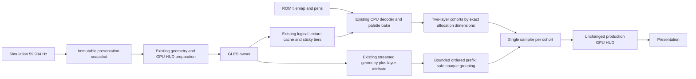

# GPU world texture atlas investigation — 2026-10-14

**Decision: retain the committed production renderer. The pixel-correct
prototype stays OFF; five pairs show higher FPS with worse frame pacing.
No deployment or commits.**
Production reference: commit `00d2b73`, GPU HUD / three-stage H700 preset;
handheld executable SHA256
`6e1cac0099a7fd9b5e7d705a2d3634dd387f7705b7ce36a8aa011742c07b5a1e`.
The production executable, launcher and existing backups remain unchanged.

## Representation

Ordinary 2D RGBA atlas relocation fails exact nearest sampling at representable
UV boundaries. Full tick-2500 affine sampling differs at 14 pixels; explicit
texel flooring differs at two. These are identified products rounding upward
in float32 where the original sampler selects the previous texel. A proposed
split-product correction fails a wider edge test and is rejected.

The selected alternative is a bounded GPU-resident RGBA **texture-array atlas**:
only equal-sized original allocations share a cohort. Each cohort has two
layers. UVs, perspective division, bake tiers, U/V scales, guards and clamp
semantics stay unchanged. Each polygon carries a constant integer layer value.
A GLES3 world shader uses a single sampler and explicit level-zero sampling;
existing GLES2 programs, including GPU HUD composition, remain in use.

## Retained semantics and ownership

- System22 ROM source, pen/cmode decode and runtime palette-generation keys.
- Degenerate UV expansion, independent integer sample steps, guards and NPOT
  dimensions. Polygons 978 and 1351 retain their individually selected tiers.
- The 64 MiB logical cache, 32-probe keys, second-chance eviction, sticky-tier
  lookups and normal GPU-owner resource selection order.
- Prepared immutable snapshots and existing VBO streaming. No new threads,
  geometry projection scheme, world/HUD resource sharing or preloading.
- GLES owner creates/uploads/releases all cohorts. A mutation drains commands
  referring to that cohort before a layer is reused. GL ordering protects
  already submitted reads; possible driver stalls must be measured.
- Empty cohorts retire behind a fence and remain charged until completion.
  Arrays including retired storage have a physical cap of twice the logical
  budget (approximately 128 MiB). Metadata is bounded at 4096 cohorts. The
  prototype reports and fails safely if that bound is exhausted; it does not
  change cache quality or silently evict additional source resources.
- Grouping never crosses a cache-mutation drain or command/vertex capacity
  boundary. Opaque priority mode, depth bits >=16, normal depth range and at
  least two conservative 16-bit depth units per synthetic rank are required.
  Shader/cohort/scissor separate groups; original equal-rank/fan order remains.
  Blended legacy rendering uses the original renderer. Commands containing an
  exactly zero-area triangle retain separate draw boundaries after sorting.
  A two-draw native reproduction proves merging such a command can affect a
  valid tiny polygon even when both use the same texture. No triangles are
  removed and no area tolerance is used.

## Isolated evidence

See [reproduction and raw measurements](tools/world_atlas_case/README.md).
Frozen normal-history tick 2500: 670 resources, 1,280 commands, 7,998 vertices,
24.89 MiB exact RGBA data. Original resources and shader inputs are captured
at draw time; this does not force resource identities between adaptive runs.

Fixed two-layer cohorts use 431 arrays / 36.49 MiB and reduce grouped draws to
441 (65.5% reduction). The initial flat-layer isolated run has median CPU
12.98 -> 6.17 ms and finish elapsed 27.11 -> 18.04 ms over 20 rotated samples.
These measurements exclude simulation, preparation, HUD, audio and pacing.
They are not GPU-only time or an estimate of full-game FPS. Final-shader
end-to-end performance is still required.

The native live test exposed a zero-area fan/flat-layer array shader difference
not present in the tick 2500 capture. Its one-polygon reproduction is preserved.
An interpolated constant-per-triangle layer and explicit level-zero sampling
pass the expanded native gate. No geometry deletion, UV bias, colour adjustment
or tolerance was used. Because GL_NEAREST resources have no mipmaps, level zero
preserves required sampling semantics while avoiding implicit LOD calculation.

## Implementation controls

Build option `RR_GLES_WORLD_ATLAS=ON` requires ordered submission and excludes
multi-sampler batching. The option defaults OFF. Runtime
`--gles-world-atlas off|ordered|group` also defaults OFF. Unsupported GLES
versions and legacy blended rendering retain the original path.

- `engine/gles_world_array_cache.inc`: bounded GPU resource lifetimes.
- `engine/gles_world_array_submit.inc`: shader, prefix grouping and live oracle.
- `GLES_WORLD_VALIDATE=<existing directory>` creates proof 2D resources from
  the exact decoded bytes of normal misses and compares original ordered draws
  with atlas draws before the unchanged HUD composition. Extra proof resources
  and readbacks are diagnostic only and excluded from performance tests.
- `GLES_WORLD_CAPTURE_TICK=<tick>` additionally captures targeted inputs and
  compares uploaded array/proof bytes. It does not select texture tiers.

Approximate extra normal CPU allocations: 240 kB layer extension in the source
vertex arena; 2.64 MB grouping stream; cohort/proof metadata 360,448 bytes;
additional command metadata. Diagnostic framebuffer readbacks and proof textures
are excluded from normal measurements. Application GPU estimates include layer
padding and retired cohorts; driver storage renaming/private memory is not
measured directly. Physical array occupancy and end-to-end RSS must be reported.

## Correctness so far

- Native final sampling: 2,297 presented pictures through tick 2500, exact world
  and original GPU HUD RGBA; endpoint JSON equals headless and preserved Mali.
- PCM through tick 2500: `a324dacc7bd8079b`, voices `088ea85b908def0c`, final sound
  `1e38a20ab23182dd`, identical headless reference; board `c63e76b3`.
- Rebuilt TSan: 566 world/HUD reference pictures through tick 1700; no application
  race; state and PCM/voice values equal prior production TSan reference.
  Existing driver-only `race:libgallium` suppression is unchanged.
- Initial live Mali shader: 350 exact world/HUD pictures through tick 2500,
  including palette generations, cache evictions and normal adaptive skips.
- Final guarded native full recording, Mali fixed-history first lap and all
  five performance pairs are complete; the results below determine retention.

## Production safety / rollback

Nothing has replaced `/userdata/roms/ports/rave-gles2/rr_gles2`; the existing
single Ports launcher remains production. Diagnostics are under
`/userdata/system/rave-racer-world-atlas-20261014/`, with frontend restoration
traps and bounded test timeouts. There is presently nothing to roll back.
No commits are created. Physical-test deployment requires all correctness and
five-pair representative performance gates; retain production if they fail.

Expanded native gate: all 2,002 pictures through tick 6006 pass world/HUD RGBA.
Endpoint JSON, full framebuffer, ordered texture misses, geometry digest,
board state and PCM/voice values are byte-identical to the preserved production
controlled-presentation run. The four-pixel tick 3462 issue is isolated to a
merged point triangle and a valid small polygon using one identical texture;
original command boundaries for zero-area-containing commands resolve it.
The final hardware controlled-history gate and five A/B pairs are complete.

Timing accounting excludes mutation-drained submission time from the texture
upload bucket, preventing a draw prefix from being counted twice. This change
does not alter GL commands/resources. The benchmark uses the production
executable versus the guarded candidate with identical first-lap, audio, HUD,
texture budget, adaptive presentation, miss trace and profiling controls.
Candidate feature compilation is independent of the production preset;
multi-sampler batching, pre-decoding and wake experiments remain OFF.

Final guarded Mali fixed history: 1,880 world/HUD comparisons through tick 5639,
including the native tick 3462 case, endpoint/board/PCM/voices exact. Physical
array peak 109.32 MiB in this diagnostic run, no retirement waits. The five-pair
measurement is complete; the final decision below supersedes provisional
first-pair results.

## Final representative performance and decision

[Complete five-pair results and five-second sections](benchmarks/world-atlas-20261014/RESULTS.md)
include raw archived traces and reproducible standard-library analysis.
The matched production median 52.931 FPS reproduces the established 52.94 FPS
reference. Each variant retains GPU HUD, audio, multicore, geometry optimisations
and 64 MiB logical cache. No resource forcing, reference readbacks or glFinish
is enabled in these ten runs. All ten endpoint JSON records match exactly.

| Metric (median of five runs) | Production | Arrays |
|---|---:|---:|
| Rendered FPS |52.931|56.019|
|1% low FPS|25.151|21.699|
|p99 interval ms|33.003|33.566|
|Worst interval ms|91.893|106.627|
|Image age median/p95 ms|37.389 /54.535|33.108 /50.715|
|Simulation Hz|59.904|59.905|
|Preparation CPU ms/picture|3.775|3.851|
|GLES-owner CPU ms/picture|16.986|15.379|
|Submission wall ms/picture|9.617|7.374|
|Decode wall ms/picture|0.449|0.435|
|Upload/driver wall ms/picture|0.472|0.865|
|World draws/picture|860.710|438.974|
|World/cache texture binds/picture|863.969|443.384|
|Dropped snapshots|445|245|
|Peak process RSS MiB|288.242|332.418|
|Audio underruns/resyncs|0 /0|0 /0|

These draw/binding counters cover the world path and its uploads. The unchanged
HUD contributes one compositor draw per picture, plus its glyph update draw
when dirty; they are not silently included in the world counters. Both variants
include their complete costs in FPS, owner CPU and image age.

Mean/median presentation intervals are18.879 /16.904 ms for production and
17.837 /16.760 ms for arrays. Median per-run interval distributions:

|Interval bin|Production %|Arrays %|
|---|---:|---:|
|<=17 ms|52.27|70.47|
|17–25 ms|39.02|24.07|
|25–35 ms|8.31|4.52|
|35–50 ms|0.47|0.56|
|>50 ms|0.12|0.25|

Ordinary frames improve while the longest stalls become more frequent and
longer. The 1%low regresses in every pair; this is not a single anomalous run.
CPU governor stays schedutil, with the same settings throughout. Candidate3
has three brief lower-frequency observations; the other four candidate runs
and every baseline stay at 1512 MHz in the measured window. All five pairs
have zero audio underruns, overruns, latency resets and simulation resyncs.

### Tick1965 loading burst

Every run's worst hitch occurs around 1965 (one baseline presents 1966 after
skipping 1965). Both variants miss 75–79 textures. Median decode time is about
25 ms. Median texture upload/driver call wall time rises from 19.366 ms to
53.193 ms. This is direct same-run evidence of an increased resource-update
cost; no unrelated diagnostic timings are added to estimate a speedup.
The measured calls include allocation, upload and driver synchronisation. The
current evidence does not isolate which internal Mali operation dominates.

The additional cost is consistent with double-layer allocation and updates to
a cohort whose other layer can still be referenced by submitted work. GL
ordering preserves correctness but can cause driver synchronisation. There
are no explicit retirement-fence waits in any benchmark run. Therefore the
regression is not attributed to the prototype's blocking retirement fallback.

### Memory, startup and resource history

The logical cache still reaches 64 MiB. Median physical array peak is 113.15 MiB,
with end allocation 90.18 MiB and 70.80% payload occupancy (including charged
retired cohorts). The physical bound is 128 MiB at the64 MiB logical setting.
Process RSS grows 44.18 MiB (+15.3%); this includes driver/working-set changes,
not just fixed CPU arenas. Application GPU allocations and RSS overlap on this
shared-memory system and must not be added together as separate RAM costs.

Launch to first completed simulation tick is0.684 s vs0.714 s (five-run
medians, warm filesystem). There is no atlas startup preloading; allocation is
lazy. GPIO/controller/SDL audio paths are unchanged.

Measured-lap misses/uploads are 7665 vs7659; evictions 8921 vs8866. Whole-process
array allocation median 7492 cohorts, 14206 uploads, 6712 hole reuses; retired
cohorts remain charged until signalled. These are lifetime counters, not falsely
labelled as racing-only counts.

A free-running first-pair miss audit finds 10,544 shared source states; eight
have differing observed tier/allocation sets. There are 38 baseline-only and 25
array-only source states. Presentation histories differ, so these are recorded
rather than forced equal. The controlled native complete recording has
byte-identical ordered miss records, and the hardware oracle compares normally
selected resources at each draw. Shader equivalence and independent adaptive
cache-history equivalence remain distinct.

### GPU timing scope

The isolated completion measurements include submission, driver and GPU
completion. They are not exclusive shader execution or active GPU utilisation.
A private supplementary build reuses the existing nonblocking
`GL_EXT_disjoint_timer_query` infrastructure. Both modes use that same build,
GPU HUD/audio/multicore and the same first lap. Multi-sampler batching remains
compiled OFF; only the timer utility is reused. Both endpoints match.

| World GPU command span | Original mode | Array grouping |
|---|---:|---:|
|Median ms|9.660|8.832|
|p95 ms|12.949|11.925|
|Maximum ms|15.095|18.612|
|Valid samples|3395|3589|
|Disjoint / ring drops / pending|0 /0 /0|0 /0 /0|

The scope is the world pass, including feeding gaps, and excludes unchanged HUD
composition. It is not active GPU utilisation or exclusive shader execution.
This supports improved ordinary world submission with a longer worst span,
and does not identify a particular Mali instruction or register-pressure
change. Its FPS is not substituted into the five-pair table; no CPU/GPU
numbers from separate modes are added to predict a frame-time saving.

### Recommendation

Do not make this prototype the production default or deploy it for physical
testing: the 5.8% throughput gain and lower ordinary image age do not justify
the13.7% 1%low regression,16.0% worst-hitch increase and44 MiB RSS growth. It
does not deliver sustained 59.904 rendered FPS. A single-sampler representation
is feasible and pixel-correct, but this bounded resource-management design
harms the texture-loading behaviour that matters to gameplay smoothness.

The committed production executable6e1cac00… and its existing launcher/config
remain active. No additional permanent launchers or commits are created. The
experimental source and diagnostic captures are retained behind OFF-default
compile/runtime controls for review; no further optimisation is pursued.
There is no deployed change to roll back.

## Final exact-resource frozen case

The final shader and zero-area draw rule also pass the preserved tick2500
scene: original fidelity, ordered arrays, adjacent arrays and opaque grouping
all have **zero differing RGBA pixels**. Exact two-layer cohorts remain 431
objects /36.49 MiB /68.21% occupancy. Current guarded draw counts are 1280,
1280, 1255 and 499 respectively. The guard changes the earlier unguarded441
count; that earlier count is not presented as the final implementation result.

Twenty rotated samples from this one frozen final-prototype run:

| Frozen mode | Median submission CPU ms | Median elapsed through glFinish ms |
|---|---:|---:|
|Original|11.880|24.974|
|Arrays, original boundaries|14.854|29.630|
|Arrays, adjacent merge|13.535|28.446|
|Arrays, guarded opaque grouping|6.857|18.456|

These figures show why reduced draw submission was promising in an immutable
case. They exclude gameplay preparation, audio, HUD and runtime resource
churn, and are not converted to a claimed racing FPS or an additive GPU saving.
The five-pair complete-game pacing regression determines the decision.

Final device checks: production executable hash unchanged, one active
`Ports/Rave Racer.sh`, no game/diagnostic processes left, EmulationStation
restored. The current production configuration and existing backups are
untouched; no rollback action is needed.
