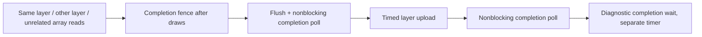

# Mali-G31 texture-array driver investigation — 2026-10-14

**Recommendation: retain production. Reject bounded cohort retention.**
The experiment establishes substantial resource-lifecycle/search cost, but
retention does not repair pacing and increases RSS by 59 MiB over the original
atlas. No atlas is enabled or deployed; no production source/executable or
launcher is changed and no commits are made.

This investigation follows `HANDOVER.md`, `GPU_WORLD_ATLAS_INVESTIGATION.md`,
`benchmarks/world-atlas-20261014/RESULTS.md` and
`RENDERING_ARCHITECTURE_REVIEW.md`. It does not repeat the rejected 2D atlas,
sampling redesign, GPU HUD, geometry or multi-sampler investigations.

Production is commit `00d2b73`'s GPU HUD / three-stage build, device SHA256
`6e1cac0099a7fd9b5e7d705a2d3634dd387f7705b7ce36a8aa011742c07b5a1e`.
The original array candidate and production executables remain independent.
Investigation source baseline is HEAD `41fb382` (Atlas Texture Investigation);
its parent production reference is `00d2b73`. Only private diagnostic copies
and new investigation artifacts are created.
No commits, launcher changes, clock changes or additional Ports entries.

## 1. Existing resource paths

Source: `engine/tex_bake.c`, `engine/gles_world_array_cache.inc`,
`engine/gles_world_array_submit.inc`, `engine/quad_gles2.c`.

| Operation | Production GLES 2D | Original exact-dimension arrays |
|---|---|---|
| Object names | `gen_texture`: `glGenTextures(512, ...)`, consumed individually | `glGenTextures(1, ...)` per cohort |
| Binding / parameters | Existing counted binding wrapper, four nearest/clamp parameters per miss | Same wrapper, array target, parameters once per allocation |
| Mutable allocation | `glTexImage2D(... GL_RGBA, w,h, ... NULL)` | `glTexImage3D(... GL_RGBA8, w,h,2, ... NULL)` |
| Initial upload | `glTexSubImage2D`, decoded rectangle | `glTexSubImage3D`, one decoded rectangle, depth one |
| Subsequent upload | GLES eviction deletes the object; desktop freelist recycling is **not** this production strategy | Existing free layer in matching dimensions, including previously occupied holes |
| Invalidation | Palette/key invalidation or second-chance budget eviction; logical resource order retained | Same logical policy; drain buffered draws for cohort, clear occupied bit |
| Retirement | Delete evicted texture after buffered references drain; GL retains submitted references as required | Empty cohort gets `glFenceSync`; physical bytes stay charged |
| Reaping | No separate array reaper | Every miss calls `world_reap(0)`, scans 4096 entries, polls each retired fence at zero timeout, deletes signalled fences/textures |
| Pressure fallback | Existing bounded logical budget | Charged physical cap = twice logical budget, plus 4096 metadata slots; existing blocking reap fallback |
| Submission | Original ordered world draws bind individual 2D objects | Original bounded prefixes group compatible cohort/scissor/shader commands; each vertex retains exact layer and UVQ |

Array mutation drains buffered CPU commands referencing that cohort; it does
not wait for submitted GPU execution. GL ordering must preserve prior reads.
The normal upload timer subtracts mutation-drained submission to avoid double
counting. However, array reaping/deletion **is inside the upload timer**;
production deletion is mainly **inside the eviction timer**. Comparing only
those upload buckets does not measure the complete incremental lifecycle cost.
The desktop NVIDIA orphaning comment in `tex_bake.c` is not evidence about Mali.

The allocation API’s short CPU duration does not establish when the driver
materializes backing pages: some allocation/format-copy work could occur on
first upload. No proprietary driver allocator instrumentation is available.

Arrays upload the same normally decoded RGBA bytes; allocating two layers does
not imply twice the bytes are uploaded. They do incur unused/retired storage.
No immutable storage API is used by either original replay path.

## 2. Instrumentation and controlled methodology

Reproducible tools are in [`tools/mali_texture_driver`](tools/mali_texture_driver/README.md).
Private relinking preserves all existing game objects except the explicitly
copied texture/submission files; production source and build objects are not
edited. CPU `CLOCK_MONOTONIC` durations separately cover generation, binding,
allocation, subimage upload, deletion, retirement fences/polls, and nested
reaping/cohort-search scopes. Draw submission already has its established
wrapper/profile timing. Submitted resource references additionally record
allocation serial, GL name, dimensions, layer, update/reference count and time
since last submitted reference to either layer. This age is **not GPU age**.

The first text traces exposed significant formatting overhead when hundreds
of retirements were polled. They are preserved as exploratory evidence, not
FPS benchmarks. The final trace buffers detailed events for ticks 1960–1970
in memory, aggregates operation counts/durations elsewhere, samples bindings
1/64, and writes text after replay. It adds no GL commands or synchronization.
Its duration breakdown is a diagnostic observation, not a five-run estimate.
Final traced full-lap throughput is 52.78 / 55.76 FPS and owner CPU
17.03 / 15.18 ms for 2D/arrays, close to the earlier 52.93 / 56.02 FPS
reference. These are workload checks, not a new statistical performance comparison.
The traced array run reports two resyncs and 332 whole-process audio underrun
samples; it is **not** an accepted pacing/audio benchmark. Those anomalies
are preserved, not attributed solely to the driver or erased. The final
normal benchmark has no API tracing and independently records audio/resyncs.
No timings from this diagnostic are added to unrelated GPU timing modes to
calculate an imagined FPS gain.

Handheld GL: `OpenGL ES 3.2 v1.r20p0-01rel0.8ec337de4ddab3365a32cff58063a9da`,
ARM Mali-G31, 256 maximum array layers. SDL requests an ES2 context, as the
playable app does; the installed context exposes GLES3 entry points. Same
Buildroot compiler/sysroot and `libmali`, SDL `mali`, 640×480, swap interval zero.

The standalone probe uses RGBA8-equivalent 2D/array storage, RGBA/unsigned-byte
client uploads, nearest/clamp, observed irregular dimensions, deterministic
nonuniform payloads, no PBOs/mipmaps/compression. Shapes: 16×16, 66×97,
130×256, 173×255, 210×250, 258×512 and 594×81; the last represents the existing
preserved world scene rather than the tick-1965 burst. Five warmup rotations,
40 measured rotations, three fresh processes per principal comparison.
Each test uploads exactly one layer/rectangle. Fresh 2D allocates one layer;
fresh arrays allocate two. Persistent eight-layer storage explicitly allocates
four times the two-layer storage, outside its update timer.

Controlled in-flight cases submit sixteen identical fullscreen array-texture
draws, create a fence after those draws, flush, poll at zero timeout, then
update storage. Same-layer, other-layer and unrelated-storage cases have the
same draw count/shader/upload bytes. The completed-read control finishes those
same draws before timing the upload. Completion waits are separate diagnostic
measurements. They are never inserted into playable/replay performance paths.
A dedicated orphaning allocation avoids invalidating another test's initialized
layer. Unsigned/nonuniform client bytes do not reproduce every live palette
payload; the replay trace is the complementary actual-workload measurement.

**Short API durations may queue work, copy to staging memory or rename storage.
They are not GPU execution durations.** An unsignalled fence proves its complete
command prefix has not completed; it does not reveal which memory read or
internal driver task remains outstanding.

## 3. Isolated findings and synchronization evidence

Final corrected probes use actual captured RGBA payloads, a dedicated
orphan allocation and the observed 594×81 shape. Each cell has 120 samples
from three processes. Full median/p95/p99/max distributions for all seven
shapes are archived in `actual-payload-summary.json`; the synthetic final
control is separate. Every in-flight fence is unsignalled before and after
its upload (120/120 for every tested shape/case).

| Controlled case | 130×256 upload median / p95 µs | 258×512 upload median / p95 µs |
|---|---:|---:|
| Fresh 2D, one layer | 344.2 / 393.0 | 903.7 / 1151.7 |
| Fresh mutable array, two layers | 324.4 / 385.0 | 719.4 / 1018.8 |
| Fresh immutable array, two layers | 330.1 / 430.0 | 715.5 / 911.6 |
| Persistent array, idle | 335.4 / 458.3 | 681.0 / 879.1 |
| Same layer, previous draws completed | 361.5 / 415.6 | 989.2 / 1157.0 |
| Same layer, preceding draws in flight | 380.9 / 494.3 | 1010.6 / 1207.4 |
| Other layer in flight | 401.6 / 649.6 | 1027.0 / 1244.0 |
| Unrelated array in flight | 368.0 / 501.9 | 1003.3 / 1161.2 |
| Orphan array storage | 397.6 / 539.5 | 1037.9 / 1270.8 |
| Rotate three allocations | 393.7 / 519.1 | 1021.7 / 1195.8 |
| Persistent eight-layer array | 357.5 / 381.3 | 911.3 / 1114.0 |
| Immutable persistent, idle | 345.7 / 475.0 | 732.2 / 921.6 |
| Immutable same layer in flight | 377.7 / 491.3 | 949.7 / 1161.6 |

Fresh allocation medians at 130×256 are 48.9 / 57.3 / 52.9 µs for 2D /
mutable arrays / immutable arrays; at 258×512 they are 44.0 / 49.9 / 38.9 µs.
These small API costs do not establish where all backing-page work occurs.
The completed-read control is nearly as expensive as the in-flight controls
at 258×512 (989 versus 1011/1027/1003 µs). Thus a longer call following reads
is not, by itself, evidence of waiting for outstanding reads. CPU cache,
shared-memory traffic, driver bookkeeping and frequency history are possible
contributors, not identified internal causes.

The initial synthetic controls are exploratory and archived separately;
final claims above use the corrected probe.

The corrected actual-payload probe gives comparable upload durations for same-layer,
other-layer and unrelated in-flight reads. All 120 fences for each of those
cases at each shape are unsignalled before **and after** the upload call.
The driver does not visibly wait for completion of the whole preceding prefix
in these measurements. This is evidence against an obligatory long,
array-allocation-wide blocking wait for these updates. It does **not** prove
that there is no partial synchronization, staging copy, storage renaming or
bookkeeping inside Mali.

Immutable storage, orphaning, three-allocation rotation and eight-layer
persistent arrays do not demonstrate a consistent update advantage. They do
not justify a larger pool or a general-purpose new allocator.

Occupancy controls retain and initialize 64 or 112 MiB of independent array
storage before running otherwise identical samples. These are diagnostic
resident texture allocations, not a claim to reproduce the game's complete
memory working set. Final actual-payload median process high-water marks are about 122.18 and
170.49 MiB. At 258×512, mutable fresh array upload median is 799 versus 777 µs;
persistent idle update is 769 versus 725 µs. Allocation and deletion remain
tens of microseconds. Higher occupancy does not explain the burst through a
monotonic slowdown in this control. Separate process frequency/scheduling and
cache effects remain; this is a negative control, not proof that full-game
memory pressure or private driver memory can never matter.

## 4. Tick-1965 decomposition and other loading bursts

Final low-overhead traced replay: ticks 1800–5639, adaptive presentations,
original HUD/audio/multicore, no proof draws/readbacks, normal 64 MiB cache.
Both endpoints match production. A separate native controlled tick-1965
capture records all 2,103 texture lookups (source rectangle, bank/palette/
cmode/generation, cap/peek/hash/opacity), 1,223 hits and 78 miss payloads.
Those ordered events and exact decoded bytes are archived independently
from the adaptive timing run; cache histories are not forced equal. The largest burst selects 77 normally
requested textures in each mode at tick 1965. Ordered miss identities and
allocation requests are retained in the raw traces; adaptive histories are
allowed to differ outside controlled correctness runs.

| Same-run CPU wall scope at tick 1965 | Production | Original arrays |
|---|---:|---:|
| Enclosing upload scope | 16.40 ms | 42.30 ms |
| Enclosing eviction scope | 27.33 ms | 8.54 ms |
| Sum of those separate lifecycle scopes (including any drains) | 43.73 ms | 50.83 ms |
| Allocation API | 2.26 ms / 77 `Image2D` calls | 2.46 ms / 44 `Image3D` calls |
| Texel upload API | 12.51 ms / 77 calls | 14.46 ms / 77 calls |
| Texture deletion API | 24.81 ms / 421 calls | 16.32 ms / 243 calls |
| Retirement fence creation | — | 5.60 ms / 233 calls |
| Nonblocking fence polls | — | 1.07 ms / 2124 calls |
| Fence deletion | — | 0.61 ms / 243 calls |

The array upload scope is almost entirely accounted for by **22.22 ms reaping
+ 5.23 ms cohort search/creation + 14.46 ms texel upload = 41.91 ms**. These
three are sequential nested scopes; allocation is already inside search,
and texture deletion/polling are already inside reaping. They must not be
added again. The 243 texture deletions occur only after their retirement
fences signal, so their 16.32 ms cannot be attributed to waiting for earlier
submitted GL reads of those retired allocations. This directly establishes
expensive lifecycle work on known-completed resources. Remaining differences include binding/parameters/bookkeeping and
instrumentation boundaries. Reaper time beyond individual deletion/poll calls
includes scans, metadata operations and diagnostic overhead; it is not assigned
to GPU synchronization without evidence.

The large upload-bucket increase is therefore primarily **resource retirement
work charged to that bucket**, plus cohort lookup/creation and somewhat higher
upload cost; it is not primarily `glTexImage3D` allocating double-layer storage.
Eviction scopes can include mutation-drained submission; their sum is not
pure driver CPU and must not be added to the separately reported submission
bucket. After accounting for production eviction, the same traced picture's complete
measured lifecycle increase is about 7.10 ms, rather than 25.90 ms. This is
one diagnostic observation, not an estimate subtracted from the earlier
five-pair 106.63 ms worst interval.

The largest array subimage calls involve 258×512 layers whose other layer was
last submitted hundreds of milliseconds or seconds earlier. Recently submitted
other-layer references exist elsewhere but do not explain these largest calls
by themselves. Reference ages are not completion checks; stale age alone cannot
prove a resource was idle. The isolated completed/in-flight controls supply the
causal comparison.

Earlier expanded traces locate substantial retirement work at tick 3386
(113 deletions, 6.97 ms; subimage 14.27 ms) and 3820 (105 deletions, 6.89 ms;
subimage 7.50 ms). They are affected by text tracing and excluded from final
performance values. `operation-sections.json` records final low-overhead
operation sums across all thirteen approximately five-second sections.

## 5. Resource lifetimes, memory and targeted candidate

Original array reaping runs for every upload and performs many independent
retirements/deletions. Polling is nonblocking and inexpensive per call; there
are no original benchmark retirement waits. Physical allocation estimates
include live, empty pending and unused cohort layers, but exclude driver-private
copies/renaming. RSS and GPU allocation estimates overlap on shared memory and
must not be added as separate RAM costs.

The one candidate retains an empty cohort **only after its existing retirement
fence signals**, deletes the fence and leaves storage charged. Matching normal
requests can reuse it; no texture selection is forced. Under the unchanged
128 MiB cap or 4096-slot limit, a complete scan first finds completed idle
incompatible storage to reclaim; pending retirements are considered only if
none exists. The preliminary candidate searched pending entries too soon:
its correctness gate reported 174 blocking-form polls despite idle storage.
It was corrected before the final performance set; the partial preliminary
benchmark is excluded. The corrected native full lap has zero blocking polls.
No new allocator, preloading, cache policy, shader, geometry, HUD or thread is
introduced. `ENG_WORLD_ARRAY_RETAIN=1` in the private candidate enables it;
unset uses the original policy. Original atlas/production binaries remain
independent. Experimental atlas compile/runtime defaults remain OFF.

`capacity_reap_calls` records reclaim attempts under the bound; it is not a
blocking-fence count. `idle_reclaims` and `blocking_fence_polls` distinguish
those paths. The candidate cannot silently retain uncharged allocations or
reuse a pending retired cohort. Partially occupied arrays preserve the original
ordered-update semantics and the tested sampling representation.

The initial isolated ordered-burst control uses 75 adaptive tick-1965 miss dimensions,
identical 7,308,064-byte payloads and known-idle storage. Across three processes and
120 samples per strategy, median full measured lifecycle/upload sum is
19.65 ms fresh/retire versus 15.48 ms persistent. Median uploads are 15.43 and
15.48 ms: avoiding allocation (2.38 ms) and retirement (1.83 ms) accounts for
the improvement. It omits the game's logical eviction/cohort searches,
in-flight rendering, simulation/HUD/audio and pacing. It justifies testing
retention; it does not predict a full-game speedup. The final actual-payload
burst uses 78 fixed-history resources, 7,630,592 uploaded bytes and
15,261,184 bytes of two-layer storage. Across 120 samples per strategy,
fresh/retire versus persistent total medians are **20.13 / 15.78 ms**;
allocation 2.46 / 0 ms, upload 15.74 / 15.77 ms, retirement 1.91 / 0 ms.
This independently confirms avoided lifecycle work, with no texel-upload
advantage. These 78-resource totals are never subtracted from the earlier
75-resource totals or gameplay timings.

## 6. Correctness

- Native retained candidate: 1,880 controlled pictures through tick 5639,
  world/HUD oracle reports no differing pixels; unchanged endpoint JSON.
  PCM `a18439c518e08e3d`, voices `c12e04d613b280fc`, final sound
  `a588e1f884d1c5f8` match the existing production replay reference.
- Native ordered-resource gate: all 12,036 miss records through tick 5639
  exactly match the preserved original fixed-history replay; final pixels
  and state match independently of the live oracle.
- Native TSan: 566 controlled pictures through tick 1700, no application race,
  endpoint exact against the original atlas TSan reference; PCM
  `07a037d8807a73cb`, voices `2af9b08554f183e5`, final sound
  `4e4ba86430d9dd5c`. Existing `race:libgallium` suppression unchanged.
- Mali complete controlled first lap: 1,880 exact world/HUD pictures through
  tick 5639; endpoint and the same PCM/voice/final-sound digests match.
  Retained physical peak stays within 128 MiB. The corrected candidate has
  zero blocking fence polls in both native and Mali controlled full-lap runs.

Retention changes only physical cohort lifetime. The normal request/cache/
palette ordering and existing oracle compare exact normally decoded bytes at
each draw. Resource reuse remains behind completed fences when a cohort was
empty; populated-cohort holes retain the original GL command ordering.

## 7. Representative performance

Five alternating accepted three-way racing windows: rounds **1, 3, 4, 5, 6**.
Rounds 1/3/5 run production → original → retained; 4/6 reverse that order.
Recorded first lap 1800–5639, same controls, HUD/audio/multicore, logical
64 MiB budget, profile/miss traces and one-second process monitor. No detailed
API interposition, reference readbacks, glFinish, timer waits or per-draw
fences. All 18 original/replacement endpoint JSON files match production.

Round two is preserved but excluded in its entirety, with that exclusion
announced before final medians: a 50.6 MiB diagnostic-binary transfer finished
at the retained run's startup, which then reported four racing resyncs and
2.28 s discarded lag. Its original/production partners are excluded too.
Replacement round six was prepared while idle, filesystem writes flushed,
and measured with no transfers. The exact initiating stall inside the
confounded run remains unproven; it is not assigned to implicit GPU sync.

Round-one production additionally reports **528,686 whole-process audio
underrun samples** and tick gaps of 2.98 s at 120 and 8.19 s at 1740. Those
observed gaps precede the measured window. Its racing window has normal
59.904 Hz, zero resyncs and no comparable simulation gap; it remains in the
racing-window comparison. The audio counter has no per-tick attribution,
so this is not silently presented as a zero-underrun process or a racing-only
counter. The other fourteen accepted processes have zero audio underruns;
all fifteen have zero racing resyncs. No observed output latency resets or
overruns. Separate correctness replay PCM/voice digests are exact.

CPU policy is unchanged. Original-array samples stay at 1512 MHz; several
production/retained runs include brief governor transitions. Three retained
runs stay at 1512 throughout and still lose 1% lows to their original partners.
Observed temperatures span 54.49–71.59 °C. Governor behaviour alone does not
explain the repeatable retention regression.

| Metric: median of five accepted racing windows | Production | Original arrays | Retained arrays |
|---|---:|---:|---:|
| Rendered FPS | 52.900 | 55.957 | 55.801 |
| 1% low FPS | 24.899 | 22.151 | 21.486 |
| p99 presentation interval ms | 32.685 | 33.807 | 35.648 |
| Worst presentation interval ms | 79.034 | 101.651 | 101.133 |
| Image age median ms | 37.634 | 33.286 | 32.648 |
| Image age p95 ms | 55.031 | 50.500 | 51.131 |
| GLES-owner CPU ms/picture | 16.986 | 15.413 | 15.370 |
| Submission wall ms/picture | 9.608 | 7.385 | 7.406 |
| Allocation/upload/retirement scope ms/picture | 0.476 | 0.865 | 0.831 |
| Decode wall ms/picture | 0.452 | 0.436 | 0.438 |
| World draws/picture | 859.991 | 439.419 | 438.685 |
| World/cache binds/picture | 863.258 | 443.834 | 442.845 |
| Peak process RSS MiB | 286.961 | 334.145 | 393.242 |
| Simulation Hz | 59.904 | 59.904 | 59.904 |

Normal benchmarks retain the established combined texture scope. Per-API
allocation/upload separation is reported only in the controlled diagnostics;
those independent timings are not distributed into this table.

| Lifetime counter / allocation | Production | Original arrays | Retained arrays |
|---|---:|---:|---:|
| Physical array peak MiB | 64.00 | 114.08 | 128.00 |
| Physical array end MiB | 64.00 | 89.73 | 127.87 |
| End logical-payload occupancy % | — | 71.15 | 49.94 |
| Cohorts allocated, whole process | — | 7494.00 | 6320.00 |
| Existing-cohort matches, whole process | — | 6714.00 | 7886.00 |

The existing-cohort counter includes filling a virgin second layer, reused
holes, and (for retention) completed empty cohorts; it is not a count solely
of overwritten layers. Peak/end array figures include charged retired/idle
storage. Driver-private allocations are not included.

| Round | Production FPS / 1% low / worst ms | Original FPS / 1% low / worst ms | Retained FPS / 1% low / worst ms |
|---|---:|---:|---:|
| 1 | 52.73 / 24.90 / 78.84 | 55.86 / 21.80 / 109.03 | 55.47 / 21.00 / 93.96 |
| 3 | 52.90 / 24.77 / 80.66 | 55.85 / 22.15 / 100.09 | 55.80 / 21.62 / 104.04 |
| 4 | 52.68 / 24.52 / 80.35 | 55.96 / 22.21 / 103.97 | 55.85 / 21.49 / 97.42 |
| 5 | 52.91 / 25.41 / 79.03 | 55.99 / 22.07 / 94.37 | 56.00 / 21.58 / 104.68 |
| 6 | 53.10 / 25.75 / 78.85 | 56.08 / 22.40 / 101.65 | 55.64 / 21.00 / 101.13 |

| Approximately five-second section | Production FPS / 1% low / worst ms | Original FPS / 1% low / worst ms | Retained FPS / 1% low / worst ms |
|---|---:|---:|---:|
| 1800-2099 | 50.13 / 19.64 / 79.03 | 55.30 / 17.69 / 101.65 | 55.91 / 17.67 / 101.13 |
| 2100-2399 | 55.90 / 29.98 / 33.57 | 58.30 / 26.85 / 40.69 | 58.30 / 24.14 / 44.03 |
| 2400-2699 | 50.67 / 25.67 / 45.28 | 54.92 / 24.01 / 48.33 | 54.31 / 21.47 / 57.70 |
| 2700-2999 | 52.12 / 31.27 / 33.20 | 54.92 / 27.29 / 40.52 | 54.71 / 25.50 / 42.68 |
| 3000-3299 | 56.91 / 32.30 / 32.00 | 57.92 / 24.89 / 47.67 | 58.12 / 25.20 / 48.03 |
| 3300-3599 | 49.72 / 21.32 / 57.74 | 51.43 / 18.89 / 66.39 | 51.72 / 18.95 / 66.09 |
| 3600-3899 | 48.52 / 23.56 / 48.39 | 51.31 / 20.73 / 58.44 | 51.92 / 20.17 / 61.52 |
| 3900-4199 | 59.11 / 35.90 / 30.93 | 59.30 / 34.01 / 32.60 | 59.09 / 29.97 / 38.71 |
| 4200-4499 | 52.11 / 21.77 / 50.08 | 54.92 / 17.90 / 58.32 | 55.32 / 17.72 / 58.77 |
| 4500-4799 | 54.12 / 24.50 / 53.91 | 55.87 / 22.38 / 59.90 | 55.90 / 21.93 / 60.87 |
| 4800-5099 | 53.90 / 30.14 / 33.56 | 56.33 / 26.40 / 44.19 | 55.90 / 28.29 / 38.20 |
| 5100-5399 | 49.51 / 30.11 / 33.55 | 56.11 / 29.68 / 34.12 | 55.50 / 28.16 / 37.37 |
| 5400-5639 | 49.17 / 27.09 / 37.46 | 54.15 / 23.04 / 47.02 | 53.66 / 24.09 / 44.18 |

| Tick-1965 burst: median of five | Production | Original arrays | Retained arrays |
|---|---:|---:|---:|
| Misses | 77.000 | 77.000 | 77.000 |
| Upload/lifecycle scope ms | 14.947 | 48.731 | 49.772 |
| Eviction scope ms | 25.180 | 11.078 | 10.401 |
| Decode ms | 23.625 | 25.034 | 24.996 |
| Submission ms | 9.130 | 10.225 | 9.633 |
| Owner CPU ms | 78.680 | 98.725 | 100.051 |
| Presentation interval ms | 79.034 | 101.651 | 101.133 |

Retention's 1% low is worse than the original array prototype in **all five
rounds**, and its p99 is worse in all five. Worst hitch improves in three and
worsens in two; the median improvement is only 0.52 ms. Retained 1% lows are
below production in all five rounds. Relative to the original arrays,
throughput is -0.3%, lows -3.0%, p99 +5.4%, RSS +59.10 MiB (+17.7%).
Relative to production, retained arrays give +5.5% FPS, -13.7% lows and
+28.0% worst interval, with +106.28 MiB RSS (+37.0%).

Retention reduces lifetime cohort allocations 7494 → 6320 (-15.7%), but still
needs 4823 completed-idle reclamations. All retained normal runs report zero
blocking fence polls. These are whole-process counters, not racing-only.
The full-lap upload scope drops 0.865 → 0.831 ms/picture, while the tick-1965
median is unchanged/worse (48.73 → 49.77 ms). Avoided churn is insufficient
under the same bound. Retained storage stays near the cap with only ~50%
logical-payload occupancy; there is no measured benefit justifying its RAM cost.

Retained lows improve over the original in only four of thirteen section
medians; nine worsen. Retained lows are below production in all thirteen
sections.
This is not a remedy that works across the lap while leaving one outlier.
Detailed age, CPU, call/binding counts, occupancy, monitor and section records
are preserved in `summary.json`, `details.json` and `sections.csv`.

### Actual affected-resource diagnostic

The final short trace explicitly associates retirement/poll/invalidation
records with the affected cohort, records mask/layer history, and compares
endpoints. The exploratory full trace's fence rows used the currently bound
object; those older rows are not treated as a retirement-identity oracle.
Both final short traces have 77 misses at tick 1965. Independent adaptive
histories are not forced equal.

| Tick 1965 CPU wall operation | Original arrays | Retained arrays |
|---|---:|---:|
| Nonblocking reaping scope | 22.54 ms | 5.13 ms |
| Search/create/pressure-reclaim scope | 5.39 ms | 15.89 ms |
| Subimage API | 14.09 ms | 15.15 ms |
| Storage-allocation API, inside search | 2.83 ms / 45 calls | 4.13 ms / 41 calls |
| Texture deletion API, inside the above scopes | 16.19 ms / 241 calls | 8.44 ms / 152 calls |
| Enclosing upload/lifecycle scope | 42.29 ms | 36.49 ms |

Retention moves reclamation from routine reaping into pressure handling.
There are still 152 deletions and 41 new allocations in that one burst.
The saving in this one diagnostic is **not** substituted for the five-round
normal median (which does not improve). Allocation/search costs, history and
pacing vary; the complete normal replay is the acceptance gate.

Process memory samples within three seconds of the burst show MemAvailable
ranges of 578–600 MiB production, 546–567 MiB original and 496–527 MiB retained.
CmaFree ranges are about 44–52 MiB, 45–52 MiB and 44–50 MiB respectively.
No sampled system-wide exhaustion explains the array burst. One-second
samples cannot rule out transient allocation/fragmentation or driver-private
pressure. RSS increases substantially beyond the difference in estimated
physical-array peaks; the responsible internal driver allocations are not
identified. They are a measured memory cost, not an assumed synchronization
mechanism.

## 8. Recommendation and evidence limits

**Retain the committed production renderer. Do not adopt either array
prototype for H700 production. Stop this investigation after the one tested
retention remedy; no larger pool or general allocator is justified.**

Established causes of the larger reported upload scope are routine retirement
and known-completed texture deletion, cohort scans/search/creation, and texel
upload. Much of the upload-bucket gap reflects where deletion is charged;
array backing-allocation API duration is a small part. Repeated isolated
controls do not show a mandatory long wait for same-array outstanding reads.
Explicit retirement waits are absent from the accepted normal benchmarks.
Retaining completed storage reduces allocation/deletion work in controlled
cases, but merely shifts substantial work to pressure reclamation in the
bounded game workload and worsens complete-lap pacing/memory.

This establishes an expensive **resource-management/lifetime workload on this
Mali driver**, not an inherent universal penalty for `glTexImage3D` or
`glTexSubImage3D`. Partial synchronization, copies/renaming, private driver
allocation and cache/bandwidth effects remain possible inside uploads; they
are not established primary causes. No active GPU execution/utilization
measurement is claimed. Existing timer spans include feeding gaps; new
resource-completion evidence is nonblocking fence status and submitted
reference history, never a sum of unrelated CPU/GPU modes.

The pixel-correct exact-dimension two-layer architecture, within its current
resource limits, is unsuitable for production on this workload. A more complex
allocator or much larger pool might behave differently, but these measurements
do not justify it. The original atlas remains independently available and OFF;
the rejected retention variant is preserved solely as a private build recipe
and diagnostic flag, not integrated into production defaults.

Final checks: production SHA256 unchanged, existing backup identities checked,
one `Ports/Rave Racer.sh`, no game/probe processes left. EmulationStation was
restored with the temporary diagnostic environment cleared (PID 3015).
No commits or production/config/launcher changes. No rollback is needed.

Raw artifacts and standard-library reproduction:
`benchmarks/mali-texture-driver-20261014/`; working binaries/captures:
`/tmp/rr-mali-array/`; device tests: existing
`/userdata/system/rave-racer-world-atlas-20261014/driver-*` directories.
