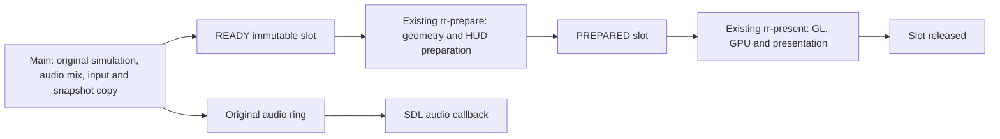

# Stage 1 — Native renderer architecture and CPU feasibility audit

**COMPLETE / STOPPED — 2026-10-15. Recommendation: GO for a limited parallel-execution prototype, subject to separate authorisation.**

There is a realistic but fragile route to 59.904 FPS: reuse the playable port's
existing three-stage infrastructure, with original simulation/audio on the main
thread, native preparation on one worker, and one GL/GPU presentation worker.
Two execution stages are insufficient with current costs. Three stages have
credible median throughput and a plausible bounded-latency schedule, but almost
no p99 headroom once contention is included. Consistent pacing is **not proven**.
A limited prototype is justified to measure that uncertainty, not to claim success.

This audit implemented **no CPU optimisation, worker/thread change, scheduling
change or new renderer architecture**. It used temporary private timing probes,
a sequential original-preparation comparator, and the existing production-threaded
executable. Stage 2 and Milestone 4B have not begun. M3 remains performance-blocked;
its <=12 ms median / <=14 ms p95 targets and the ultimate consistent 59.904 FPS
objective are unchanged. No commit, push or production deployment.

## 1. What is scheduled today

The playable port already implements three stages, not merely two threads.
[`rr_presentation.c`](src/rr_presentation.c) owns three bounded slots with states
FREE→WRITING→READY→PREPARING→PREPARED→READING→FREE. Main owns simulation and input,
original master/slave DSP execution, sound CPU/C352 mixing and publication of an
immutable video snapshot. `rr-prepare` performs original world preparation and
HUD preparation. `rr-present` owns the GL context, texture lookup/baking/upload,
world/HUD composition and swap. SDL's audio callback independently drains the
original atomic SPSC audio ring. The game never moves into the rendering workers.

Every emulated video boundary advances palette generations and latches/consumes
the direct FIFO even if no picture is published. Snapshots contain polygon RAM,
point RAM, raw palette/mixer/CZ data, character/text RAM, attributes, direct FIFO
and generation metadata. They contain no pointers into mutable simulation state;
HUD pointers refer to arrays owned by the same slot. Palette conversion is applied
by the GL consumer; the preparer avoids mutating the GL consumer's palette state.
Locks cover ownership/metrics, not simulation, bulk copies, preparation or GL work.
Main detaches the GL context and the existing consumer makes it current.

The native prototype deliberately disables this route. Its private bridge insists
on `--presentation-thread off`, then runs **simulation→walk→compile→GL/HUD/final
GPU fence→swap on one main thread**. Those operations cannot overlap with the next
tick. It still has a separate audio callback and driver threads; it is not literally
a single-threaded process. The final fence waits roughly 7.5 ms in prior hardware
measurements while the next simulation cannot run. OS migration across cores does
not create concurrency for these sequential main-thread phases.

The source is [`compiler.inc`](native/live/compiler.inc), the private builder
[`build_live_prototype.py`](native/tools/build_live_prototype.py), and original
[`rr_main.c`](src/rr_main.c), [`rr_gl.c`](src/rr_gl.c),
[`rr_gles2.c`](src/rr_gles2.c) and [`rr_audio.c`](src/rr_audio.c).

### Actual production-threaded measurements

The exact diagnostic copy of production executable SHA256 `6e1cac0099a7fd9b5e7d705a2d3634dd387f7705b7ce36a8aa011742c07b5a1e`
ran its existing independent three-stage mode with audio and built-in profiling.
It completed all 6,006 ticks and all 21 authoritative checkpoint sets. Simulation
rate was **59.786 Hz**, presentation **53.774 FPS** within the producer period.
There were 5,404 total completions, including two after the producer period, so
602 ticks had no presented picture: 586 mailbox drops plus 16 pacing-selection
omissions. Four clock resynchronisations discarded 169.059 ms of wall-clock debt;
no emulated tick was discarded. These are baseline policies, not acceptable ways
to manufacture consistent every-picture native performance.

During ticks 1800–6006, measured thread CPU utilisation was approximately:

| Role | CPU core equivalents | Observed last-CPU sample counts, cores 0/1/2/3 |
|---|---:|---|
| Main simulation/publication | 0.781 | 55 / 32 / 24 / 29 |
| Existing GL/presentation worker | 0.890 | 33 / 32 / 56 / 19 |
| Existing preparation worker | 0.210 | 29 / 41 / 28 / 42 |
| SDL audio callback | 0.009 | 35 / 5 / 44 / 56 |

The three game workers together used about 1.88 cores. Driver/audio helpers add
load; four physical cores were available. There is **no fixed role→core affinity**:
workers are OS-scheduled and migrate. `/proc` last-CPU counts are observations, not
CPU-time percentages assigned to each core. Per-thread CPU time uses 100 Hz kernel
accounting over the sampled race window; intervals are 0.5 seconds. Main, preparer
and presenter had nice 0; the existing SDL audio callback had nice -20. No affinity,
priority, governor, clock or OS policy was changed. Native audit main-thread probes
likewise observed all four cores; the native main thread executes its stages serially.

For 3,800 race pictures actually presented by the existing threaded port:

| Metric (ms) | Median | p95 | p99 | Worst |
|---|---:|---:|---:|---:|
| Original prepared world CPU | 3.649 | 4.732 | 5.332 | 6.537 |
| Original prepared HUD CPU | 0.041 | 0.058 | 0.093 | 0.305 |
| Original GL worker CPU | 15.885 | 23.260 | 29.723 | 76.990 |
| Original presentation interval | 16.801 | 26.484 | 31.580 | 77.543 |
| Publication-to-presentation age | 35.789 | 52.482 | 58.593 | 103.214 |
| Snapshot copy/publication wall time | 0.640 | 0.954 | 1.167 | 3.121 |

The GL worker is the largest production execution-stage CPU demand. Snapshot
preparation is not a 14 ms workload in this current build: historical source
comments quoting ~14.6 ms preparation and ~23 ms GLES CPU are stale calibration,
not current measurements. GPU draw wall and fence wait are not isolated GPU-time
measurements. Native GL-thread CPU was 2.689 ms median in the serial control, a
major reduction from the original threaded GL workload; those different execution
contexts are not a paired total-CPU comparison.

The original ring produced **3,949 audio underrun samples**, versus ~3.6 million
in the earlier serial native run. This strongly supports restoring independent
simulation scheduling rather than changing original audio logic. It does not
prove zero-underrun playback or perfect simulation pacing; original simulation
wall median/p95/worst was 11.474/13.951/69.117 ms across all 6,006 ticks. The existing
profiler does not export raw production simulation samples, so its p99 is unknown;
no p99 is invented from those aggregate logs.

## 2. Matched original versus native preparation costs

For each native picture, a diagnostic immutable snapshot was passed to the
**existing** `rr_gl_presentation_into` preparation API. Original and native work
ran sequentially on the same thread using the same source tick, point data,
geometry and hardware conditions. Which ran first alternated by tick. This is
shadow profiling, not a new renderer pipeline. Snapshot copy and shadow work are
excluded from native service estimates and separately reported. Source quad counts
must agree every tick. Original and native walks share small provenance hooks in
the private geometry build; the original shadow is not claimed to have zero probe
cost. Original palette activation, HUD preparation and backend clipping/texture
work sit outside that original world-preparation API.

All 4,207 native command packets match the pre-audit validated host replay byte
for byte, **without normalization**, including the newly supported tail through
6006. The original M3 window separately retains all 5,152,196 commands. Host and
both H700 audit modes pass all 21 original CPU/RAM, board/video and PCM/voice
checkpoint sets; original/native geometry counts agree throughout.

Fine-probe-disabled control results, thread CPU unless marked wall:

| Matched metric (ms, 4,207 samples) | Median | p95 | p99 | Worst |
|---|---:|---:|---:|---:|
| Original complete world preparation | 3.839 | 5.074 | 5.739 | 11.034 |
| Native original-engine walk/capture | 3.340 | 4.323 | 4.869 | 7.081 |
| Native command compiler | 7.231 | 9.524 | 10.788 | 13.080 |
| Native walk + compiler, paired sum | 10.591 | 13.811 | 15.437 | 18.385 |
| Native minus original, paired per-tick difference | 6.722 | 8.836 | 9.979 | 12.640 |
| Raw immutable snapshot copy, wall | 0.440 | 0.523 | 0.674 | 3.709 |

The genuine measured **frontend** overhead is 6.722 ms CPU median, not the sum of
independently chosen percentile values. Native walking is slightly cheaper than
complete original preparation because original preparation includes sorting; native
then pays its own compiler sorts. This frontend excess must not be called whole
renderer overhead: part of the native compiler replaces original work performed
later in the GLES backend. The earlier serial full-pipeline comparison was only
~3.2 ms slower, and the native backend has much lower CPU cost. Those contexts are
not sufficiently paired to assert an exact whole-renderer CPU saving.

Ordering sensitivity was small: compiler CPU medians 7.188 ms native-first versus
7.264 ms original-first. Adjacent even/odd scenes can have different workloads,
so this is a bias check, not a causal cache experiment. Across the same 3,800
selected production-threaded ticks, original preparation CPU was 0.960× the shadow
cost at median and 1.079× at p95. That does **not** establish a universal concurrency
penalty. Snapshot publication wall cost was 1.431× at median, including extra
producer bookkeeping. Production simulation wall mean was ~12.5% higher than
control over the same full 6,006 tick sequence, but cache, scheduling, profiler and
output context differ; it is a risk proxy, not isolated native contention.

## 3. What consumes the compiler time

Detailed mode uses the H700 generic virtual counter at 24 MHz for exclusive bucket
boundaries, plus whole-stage wall/thread-CPU clocks. Counter tick resolution is
41.667 ns; back-to-back median measured zero ticks and p95 one tick, which **does
not mean probes are free**. Compiler CPU median increased from 7.231 to 7.561 ms
(+4.57%); wall median increased from 7.304 to 7.637 ms. Walk callback instrumentation
increased walk CPU median ~6.7%. Feasibility uses the disabled-probe control, not
these inflated totals. All raw timings, including preemption/outliers, are retained.
Bucket reconciliation differs from whole compiler wall by ~0.002 ms median.

| Detailed exclusive bucket | Median ms | p95 ms | p99 ms | Worst ms | Share of summed bucket time |
|---|---:|---:|---:|---:|---:|
| initialization | 0.602 | 0.707 | 0.870 | 3.984 | 7.89% |
| mesh resolution | 0.410 | 0.552 | 0.642 | 2.449 | 5.38% |
| uv brightness | 0.614 | 0.882 | 1.037 | 2.167 | 8.06% |
| material palette resolution | 1.867 | 2.411 | 2.653 | 5.386 | 24.28% |
| transforms clip protection | 0.552 | 0.788 | 0.892 | 3.949 | 7.22% |
| conservative culling | 1.930 | 2.676 | 3.092 | 5.600 | 25.39% |
| direct geometry | 0.016 | 0.018 | 0.019 | 0.190 | 0.21% |
| painter sort | 0.483 | 0.701 | 0.832 | 3.639 | 6.39% |
| depth assignment | 0.035 | 0.048 | 0.071 | 0.317 | 0.47% |
| batch sort | 0.503 | 0.728 | 0.896 | 1.928 | 6.67% |
| instance dedup | 0.177 | 0.312 | 0.403 | 2.035 | 2.46% |
| visible sort | 0.378 | 0.625 | 0.727 | 4.019 | 4.91% |
| groups | 0.025 | 0.039 | 0.044 | 0.206 | 0.33% |
| packet copy | 0.025 | 0.033 | 0.049 | 0.301 | 0.34% |

Bucket medians do not add to the median compiler time. Shares use totals across
all pictures; no synthetic de-biasing or subtraction is presented as measurement.
Initialization includes palette gathering plus dynamic-buffer zeroing; material
resolution includes recipe construction/result assignments, not just `memcmp`.
Direct-material work is included in the direct bucket. Sorting totals about
1.36 ms median across the three sorts; packet copying and instance deduplication
are **not** the main bottlenecks.

Evidence-supported opportunities, **identified only, not implemented**:

- **Palette/material resolution and gathering:** all 128 planar palette groups are
  gathered each picture, then binary-search recipe lookup and exact 768-byte palette
  comparison repeat per source quad. Nine sampled scenes use only 18–36 groups,
  with 1,028–2,157 lookups but 429–775 unique recipes. Per-group revision validation
  and collision-safe cached recipe resolution could avoid repeated work. Any cache
  must preserve exact palette identity and advance with original video ticks;
  gamma/LUT/shadow behaviour remains separate and unchanged.
- **Immutable mesh metadata:** static UV bounds/recipe components are reconstructed
  from each captured quad despite immutable code/packet identity. Offline metadata
  could eliminate repeated bounds/key work with exact ROM/provenance validation.
- **Conservative culling/transform work:** the original geometry walk already
  projects/clips vertices; the compiler repeats transforms/error enclosures for its
  proven float32 cull bound. Reuse may be possible, but replacing that bound with
  ordinary projected screen bounds is **not** a proven equivalent optimisation.
  Near clips, degenerate/protected quads and synthetic-depth ties must retain their
  original correctness guarantees.
- **Sorting/data motion:** painter and batch `qsort` move 128-byte commands, then
  visible indices are sorted. Index/permutation approaches merit measurement, but
  any change must preserve the exact painter ranks, ties and protected batches.
- Deduplication (~0.177 ms) and final packet copying (~0.025 ms) offer little return
  compared with lookup/culling/initialization. A speculative hash-map or broad
  copy rewrite is not justified by this audit.

These are measured cost centres and observed redundancies, not achieved savings.
Even removing one bucket in a spreadsheet would not prove a safe implementation.

## 4. Proposed architecture and safety assessment — not implemented

**Reuse the production main/prepare/GL workers and ownership machinery.** Replace
only the preparation payload with native commands and immutable original HUD data.
Keep the original simulation, audio mixing, input, video latch and direct FIFO
consumption on main. One preparer owns geometry/compiler scratch; one GL consumer
owns all GPU resources and SDL/EGL context. There is no reason to add a second GL
context or reconstruct gameplay logic. CPU-only stages and GPU work can then
operate on different ticks concurrently.

Required ownership work is substantive:

1. Replace native reads of `g_rr` palette/mixer/text and the live direct FIFO with
   a const snapshot input. FIFO latch/consume must still occur once on main at the
   original boundary; workers must never consume or mutate authoritative state.
2. Replace single `live_slot`, `live_frame` and `live_prepared` handoff with per-slot
   immutable payload, tick ID and ownership. Protect against slot reuse until GL
   submission/completion no longer needs the CPU data. Join/drain before teardown.
3. Reuse `rr_gl_video_prepare`/`rr_gl_video_submit` ownership principles so font,
   tilemap, palette, scroll, shadows and dynamic LUT belong to the same picture.
   Current `rr_gl_video_compose` reads live state and is unsafe on a concurrent
   native consumer. Renderer frame/cache globals need single-owner treatment;
   geometry scratch is safe only under one preparer and is not automatically TLS.
4. Retain source-command accounting, full-state/audio checkpoints and exact native
   packet parity. Point-RAM/solid/unseen asset formats remain explicit failures;
   this prototype would not establish menus/other-track coverage.
5. Review the existing **6 ms prep coalescing delay and newest-ready/drop policy**.
   They were designed to avoid wasting GLES CPU. Blind reuse would create latency,
   hide missing pictures and invalidate an every-picture feasibility test. A bounded
   prototype must record every admission/drop/backpressure event and fail its gate
   on missing pictures or altered main/audio timing; it must not block simulation
   invisibly to make the renderer appear stable.

Raw snapshot size is **1,182,152 bytes**, including the 512 KiB point-RAM reservation;
three raw slots are 3,546,456 bytes. Three maximum 512 KiB compact payloads make a
conservative combined raw+compact reservation **5,119,320 bytes (4.88 MiB)** before
alignment/ownership metadata. HUD raw arrays and small prepared palette/LUT data
are already in the raw-slot layout; GPU HUD mode does not need CPU RGBA HUD planes.
An **8 MiB incremental CPU-buffer cap** is a reasonable proposed limit to validate,
not an allocation implemented here. Reuse existing scratch/resources where possible;
no unbounded arenas or increased 512 MiB native static-resource ceiling.

Stage1 diagnostic RSS peaks were 749,560 / 751,104 KiB in detailed/control runs,
with minimum MemAvailable 144,976 / 137,324 KiB in this fresh environment. Earlier
whole-live validation had only ~114.5 MiB minimum available and an OOM under stale
RAM-file pressure. Five extra MiB appears affordable in this scene but is not a
whole-game memory guarantee. Retained legacy textures (~66 MB requested) plus
native assets, driver allocation, loading peaks and unknown state working sets
still require a whole-live budget. Existing PREP log's unconditional `extra_hud_bytes`
reservation is not proof those CPU HUD planes were allocated in GPU HUD mode.

Complexity is **medium-high integration work**, rather than a renderer rewrite:
snapshot adapters, per-slot native/HUD ownership, shared-global audit, queue policy,
GL-context lifecycle, legacy/native transition, bounded memory and deterministic
shutdown all need validation. Existing code materially reduces that work, but simply
moving `rr_native_prepare` to another thread is unsafe. Main-thread starvation,
cache/DRAM contention, audio underruns, extra input latency and accidental picture
replacement are the principal risks. No timing/physics/audio shortcut is acceptable.

## 5. Quantified feasibility and its limits

Control-run joint per-tick wall times supply the model. Sequential diagnostic
shadow-original work is excluded because it is not part of the native product.
Snapshot copy is charged to main. Native first-frame cold GPU cost and every tail
remain included. The model is **native phase only (1800–6006)** and starts with an
empty pipeline; legacy-to-native drain/transition contention is not modelled.
It is not a replacement for measuring the real transition.

| Service cost (ms) | Median | p95 | p99 | Worst |
|---|---:|---:|---:|---:|
| Original simulation | 10.555 | 13.722 | 15.385 | 18.518 |
| Snapshot copy | 0.440 | 0.523 | 0.674 | 3.709 |
| Native preparation | 10.716 | 14.134 | 15.770 | 18.870 |
| World/HUD completion | 10.251 | 12.128 | 13.553 | 21.685 |
| Two-stage: simulation+copy+preparation | 21.653 | 26.888 | 29.564 | 34.629 |
| Two-stage: preparation+render | 20.795 | 25.670 | 28.965 | 36.067 |
| Ideal three-stage busiest service | 11.646 | 14.978 | 16.432 | 21.685 |

**Two-stage NO-GO with unchanged costs:** either common split leaves a median
serial service of 20.80–21.65 ms. It needs roughly 4.10–4.96 ms of measured service
savings just to reach the deadline, before any margin. Enabling only one worker
cannot solve that current bottleneck.

For three stages, mean services fit the target period and aggregate application
CPU demand projects to roughly **1.5 core equivalents at 59.904 Hz**, excluding
unmeasured driver/OS effects. That fits four available cores in aggregate but says
nothing about single-stage tails. The baseline model adds an assumed **0.1 ms per
stage** for handoff/scheduling; original measured lock acquisitions averaged
~0.26–0.60 microseconds, with observed maxima 86–168 microseconds. The 0.1 ms
allowance is a scenario, not a measurement of a native parallel implementation.

The baseline busiest-service median/p95/p99/worst is **11.746/15.078/16.532/21.785 ms**:
only ~0.161 ms p99 margin remains. Some individual services exceed the period, so
buffering is necessary even with no additional contention. A FIFO, three total
in-flight slots and fixed presentation targets were simulated offline, retaining
all ticks and pictures. GPU-thread pacing waits until the fixed target and cannot
start rendering into the same backbuffer before its previous presentation.

| CPU slowdown assumption | Late at two-period target (33.387 ms) | Late at three-period target (50.080 ms) | Three-period max latency ms | Producer backpressure events |
|---|---:|---:|---:|---:|
| 0% | 1429 | 0 | 50.080 | 0 |
| 10% | 2755 | 163 | 121.870 | 109 |
| 20% | 3658 | 396 | 354.589 | 183 |
| 30% | 4158 | 911 | 742.125 | 303 |

CPU slowdown affects simulation/preparation/copy and the measured CPU component
of the GL service. Independent GPU/DRAM stress was also tested: simultaneous 10% /
20% CPU+GPU inflation gives 166 / 403 late three-period targets. Applying measured
production p99 copy cost (1.167 ms) to every tick still gives zero late targets in
the no-contention case. A separate **illustrative proxy**, applying production's
~12.5% simulation wall-mean increase and 1.431× copy factor but no prep/GPU slowdown,
gives seven late targets, worst latency 51.598 ms. None is measured native concurrency.

This exposes the difference between **average throughput and consistent pacing**:
the arrival-limited model can average close to 59.904 while suffering long bursts
and late pictures. Do not use its average as FPS proof. The 50.080 ms target is an
explicit **three-tick pipeline latency**, not a relaxed frame period. Every picture
still has a 16.693 ms cadence target. A two-tick latency is insufficient even in the
base case; three ticks nominally absorb its measured tails. Input sampling phase,
scanout and actual audio/visual alignment add further latency not measured here.
The original port's publication age already has 35.789 ms median / 58.593 ms p99;
that differs from tick-start/input-to-photon latency and is not direct user approval
of a new pipeline delay.

At 10% CPU inflation, preparation p99 alone becomes ~17.447 ms including 0.1 ms
handoff: about **0.754 ms p99 saving** is needed merely to fit one period, or ~1.754 ms
for 1 ms headroom. A hypothetical constant 2 ms preparation saving reduces modeled
three-period misses from 163 to three, not zero; simulation tails remain. At 20%
inflation the same hypothetical saving still leaves 115 misses. These hypothetical
savings were **not implemented or credited as achieved performance**. Lookup and
initialization offer measured cost pools large enough to investigate, but compiler
work alone cannot compensate for arbitrary main-thread contention.

The known standalone renderer target also has limited margin: ~10.25 / 12.13 ms
median/p95 in control leaves only ~15% relative p95 inflation before the unchanged
14 ms target is exceeded. Extra GPU/memory contention must be measured, not assumed
away. M3's failed original benchmark remains blocked; live-context results do not
retrospectively pass it.

## Recommendation and Stage1 exit

**GO for one limited, isolated three-stage parallel-execution prototype**, reusing
the existing main/preparer/GL ownership infrastructure with native snapshot adapters.
The evidence supports testing the architecture: two-stage service costs cannot
fit, three-stage baseline service costs can, renderer-thread CPU demand is much
lower, and the existing pipeline demonstrates near-target simulation/audio feed.
**NO claim that the unchanged native compiler will deliver consistent 59.904 FPS.**
Tail margin is fragile, 10% contention breaks the strict buffered model, and true
native cache/DRAM interaction, transition behaviour and display pacing remain unknown.

A separately authorised prototype should initially retain current compiler/shaders
so architectural effects can be isolated. Cap in-flight slots at three and extra
CPU buffering at 8 MiB; preserve the 512 MiB static-resource ceiling. Require complete
6,006-tick checks, all 4,207 native pictures/source commands, exact host packet parity,
all authoritative checkpoints, matching sampled priority/HUD/visual output, and
measured audio/simulation/presentation tails. Record and fail on hidden replacements,
producer stalls, queue overflow, resource-budget violations or determinism errors.
Include the first native picture and legacy transition. Further CPU optimisations
or broader live/interactive integration would require their own authorisation.

This is a **bounded feasibility experiment recommendation**, not production approval.
No Stage 2 or Milestone 4B code was implemented. All three H700 profiling runs exit0
and pass all 21 checkpoint sets; final protected-file integrity covers 47 unchanged
hashes. EmulationStation is restored and no profiling game remains. No production
files, controller settings, saves/replays, original simulation/physics/audio or
persistent OS settings were changed. No commit or push. **STOP at Stage1.**

Evidence and reproduction: [native-stage1-20261015](benchmarks/native-stage1-20261015/README.md).
Raw CSVs, task samples, checkpoint proofs, control/probe comparison, source-level
redundancy samples and the full sensitivity model are retained. Models are offline
arithmetic only; no architectural implementation is hidden in the analysis tools.
