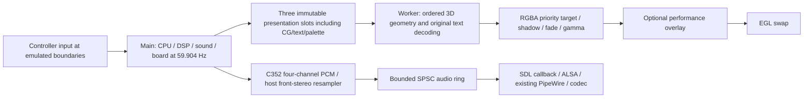

# Rave Racer ARM64/GLES2 playable evaluation build — 2026-10-13

**Status: original HUD, audio and controls physically confirmed by the user;
consolidated primary deployed after regression/performance validation.**
This is a playable evaluation build, with the fidelity/coverage limits below.
Original and threaded recovery executables and all identified experiment results
are preserved outside Ports. No repository commit was created.

## What was missing

Rave Racer's standard System 22 board uses the C305-style 64x64 text tilemap,
16x16 four-bit characters, and the polygon layer; this is not the Super System
22 C355 sprite path. The existing `rr_gl.c` character decoder and desktop layer
composition were excluded from GLES2. Character RAM is 0x1e000 bytes, with the
last character bank overlapping 0x2000-byte text RAM. Tile words select character,
flips and a palette nibble. Pen 15 is transparent. Mixer registers supply scroll,
text palette base, shadow multipliers, fades and original per-channel gamma PROMs.
The original fonts, gauges and indicators are reused; no replacement HUD is drawn.

`rr_gl.c` now reuses its existing decoder for GLES2. The presentation snapshot
contains character RAM, text RAM and tile attributes, alongside its existing
palette and mixer data. The worker reads those immutable arrays, not live emulation
memory. The producer still consumes every hardware command at the original video
boundary. Unchanged character/text/palette/scroll data reuses decoded layer pixels.

Polygons write their original priority-over-character bit into an RGBA target's
alpha. A GLES2 composition pass applies text only where polygon priority permits,
integer shadow multipliers (`floor(channel * multiplier / 256)`), and the original
fade/gamma LUT. This avoids depending on alpha bits in Mali's window framebuffer.
The LUT PROMs must be loaded in GLES2 as well as desktop builds.

Tracked logical video resources: three 640x480 RGBA textures, one depth16 buffer
and a 256x1 RGBA LUT: **4,301,824 bytes**, excluding opaque driver padding/storage. These are additional to the unchanged 64 MiB
polygon-texture budget. CPU text/shadow buffers total 2,457,600 bytes; cached raw
text inputs and the snapshot extension are fixed startup allocations, not
per-frame allocations. Dirty layers upload two full images; this cost must be
reported rather than assumed negligible.

Native captures at frames 600 and 1700 show original course-selection lettering,
track map, race position, record/time displays, speedometer, tachometer and gear.
This visual inspection does not establish complete fidelity against an arcade
reference. Existing GLES2 limitations such as polygon fog remain to be assessed.

## Audio

The translated sound CPU, ROM banking, peripheral service and C352 already generate
four-channel PCM. GLES2 used `RR_HEADLESS`, unintentionally excluding the existing
SDL host-output code. The SDL output path is now available in GLES2; device I/O is
performed by SDL's callback, separate from simulation and presentation.

`--audio on|off`: interactive defaults on, scripted defaults off. The existing
front-left/right stereo routing, 48 kHz signed-16 output and linear resampler are
reused. C352 still generates its original ~85,333.333 Hz samples at unchanged
emulated times. Resampler drift correction affects only host playback, not chip
PCM or state. The existing cabinet gain and limiter also affect only host output.
The bounded SPSC ring holds 16,384 stereo frames (64 KiB); target fill is 60 ms,
SDL callback request 512 frames. Atomic telemetry exposes fill, underrun samples,
overrun samples and latency resets without inspecting the chip from another thread.

Knulli's default ALSA device routes through PipeWire. SSH commands require
`XDG_RUNTIME_DIR=/var/run`, as established by `/etc/profile.d/xdg.sh`; otherwise
SDL fails with `ALSA: Couldn't open audio device: Host is down`. The candidate
launcher supplies this environment default without changing system files or
forcing a different audio route. The hardware smoke test opened 48 kHz stereo via
ALSA and recorded zero output underrun samples. Speaker/headphone audibility,
music and effect completeness were confirmed by the user during physical interactive testing (HUD, controls
and audio reported correct).

## Performance overlay

`--overlay off|compact|expanded` (default off). Physical **X** using the saved
RG40XX H EmulationStation mapping (SDL controller Y), or keyboard **F3**, cycles
these modes. This button was unused by the GLES2 gameplay bridge. START+SELECT
still quits; steering, accelerator, brake and view controls are unchanged.

The overlay uses the existing 8x16 bitmap font, a 16 KiB alpha atlas and a bounded
vertex buffer. It renders above original graphics. Linux diagnostics sample once
per second, never once per polygon/sample. Completely disabled mode creates no
font resources and performs no `/proc` or sysfs sampling.

Frame intervals use monotonic timestamps immediately after `SDL_GL_SwapWindow`
returns. They measure completed presentation API calls, **not GPU execution time
or independently verified physical scanout**. The rolling window holds 300
intervals, excludes the first 120 presentations after enabling, and resets when
disabled. FPS is reciprocal mean interval. 1% low is reciprocal mean of the
slowest `ceil(0.01 * interval_count)` intervals. There is no reliable game-loading
detector; disable/re-enable to exclude a transition manually. Initial partial
windows are shown with their actual sample count.

Expanded mode displays `/proc/stat` overall/per-core utilisation, process-task CPU
percentages (100% = one core), CPU0 frequency, GPU frequency if exposed, RSS,
MemAvailable, labelled CPU/GPU temperature when matching sensors exist, and audio
buffer/underrun information. Snapshot queue/drop counters are read under the short
mailbox mutex; age is publication-to-swap-return, not total controller-to-display
latency. GPU utilisation remains N/A because no reliable counter interface was found.
The handheld exposes CPU/GPU thermal sensors and cooling-state counters. Cooling
state is reported explicitly, not inferred from low frequency; zero means no
active limit from that cooling device. Unavailable metrics remain N/A.

## Reproducible builds

CMake presets select all previously validated flags: ordered submission, index
ordering, projection reuse, threaded presentation, WRAM reads, split memory reader
and inactive C352 mixing. Detailed instrumentation is off. Individual source
flags and the single-threaded reference remain available; rejected indexed GPU
submission is not enabled.

```sh
cd ~/dev/namco22-decompile/raverace
cmake --preset playable-native
cmake --build --preset playable-native
cmake --preset playable-knulli
cmake --build --preset playable-knulli
```

The Knulli preset uses `~/dev/knulli-scarab/output/h700/host`, the existing H700
Buildroot compiler/sysroot and `cmake/knulli-aarch64.cmake`. Override KNULLI_HOST
with `-DKNULLI_HOST=/path/to/host` when configuring. Do not use Ubuntu's generic
ARM64 compiler. The binary links SDL2/GLESv2/EGL/Mali and glibc, not desktop libGL.

Runtime example (native ROM path shown):

```sh
./build/playable-native/rr_gles2 extracted --interactive --timing independent \
  --skip-geometry-on-dropped-frames on --texture-budget-mib 64 \
  --vbo-upload frame --audio on --overlay compact
```

`--video-layers off` restores the previous 3D-only path for regression/performance
comparison. `--presentation-thread off` retains serial presentation.

## Separate handheld candidate

Do not overwrite `rave-gles2/rr_gles2` or `rr-thread-final-arm64` during evaluation.

```sh
scp build/playable-knulli/rr_gles2 root@192.168.1.69:/userdata/roms/ports/rave-gles2/rr-playable-candidate-arm64
scp tools/RaveRacer-Playable-Candidate.sh 'root@192.168.1.69:/userdata/roms/ports/Rave Racer - Candidate.sh'
ssh root@192.168.1.69 'chmod +x /userdata/roms/ports/rave-gles2/rr-playable-candidate-arm64 "/userdata/roms/ports/Rave Racer - Candidate.sh"'
```

Candidate log: `/userdata/roms/ports/rave-gles2/rave-playable-candidate.log`.
Original working binary SHA256:
`79f7abe165562b0dbf6e653a059fb0e3300cc936965ed59b45a9d6ae87ab242f`.
Previous threaded binary SHA256:
`2eb5e2e008a8d9c4ad3ef8d06c96fef97e81250ac1c55e529271a2999e555323`.
The evaluation candidate has since been archived. The active primary is now
`/userdata/roms/ports/rave-gles2/rr_gles2`, SHA256
`80d36fc2c536c4931da41491aa097be60e5cbcb24efbb036d940cd91bc438e7f`.
One active launcher remains: `/userdata/roms/ports/Rave Racer.sh`, displayed as
**Rave Racer**. The new persistent log is `rave-gles2/rave-racer.log`.
Candidate deployment commands above describe the separate validation stage;
use the final launcher/executable paths for the consolidated installation.

## Validation ledger

- Native desktop `rr`: built successfully in a fresh build directory; old cached
  desktop build points at a previous Windows-mounted checkout and was left alone.
- Native headless: repeated-state/environment/input/counter/CLI regression passed.
- Native snapshot/thread/drop equivalence: frames 600, 1700 and 3600 passed pixels,
  ordered geometry, board/video digests, simulation state, PCM and voice state;
  fixed-presentation texture event streams identical at all three checkpoints.
- Real C352 standalone baseline/fast transcripts: 4,615 state/register checkpoints
  and PCM byte-equivalent. No C352 implementation change in this milestone.
- GLES compositor fixture: seven readbacks passed text transparency, priority,
  shadow arithmetic and nonidentity per-channel LUT tests.
- Overlay clock fixture: 300-interval rolling FPS/1% low and mode reset passed.
- ARM64 candidate compiled with SDK; ELF interpreter and target dependencies
  verified. Mali smoke test frame 600 completed with no traps/DSP faults and
  zero output underrun samples; EmulationStation restored.
- User physically confirmed original HUD/menu graphics, controls and audio correct,
  and exited cleanly. The interactive log includes zero audio underruns.
- ARM64 serial/snapshot/thread/drop/audio-on checkpoints 600, 1700 and 3600:
  identical pixels, simulation state, board/video and geometry digests, PCM/voices;
  fixed-presentation texture event sequences identical. Known-good hashes preserved.
- Native ThreadSanitizer: audio+expanded overlay at 600 and 1700 completed without
  reported races. The sanitizer-only build uses PORTABLE=OFF: glibc symbol pinning
  otherwise collided with sanitizer scanf interception. Production flags unchanged.
  Native dummy-audio underruns under instrumentation are not handheld measurements.
- ARM64 C352 fixture output matches native byte-for-byte, SHA256
  `49e64a6eb10f16deed1ce74702f7f3a7090988025a8f1e0107c25998db24d235`.
- ARM64 overlay clock and actual Mali compositor fixtures passed.
- Five alternating trials for all four conditions completed; all 20 dense runs
  produced identical simulation JSON. All 15 HUD/audio/overlay runs had zero
  output underruns, overruns and latency resets.
- 18000-frame full-featured stability run: no traps/unmapped accesses/ROM writes,
  DSP or sound faults, resyncs or discarded lag; zero audio underruns/overruns;
  simulation 59.903992 Hz. Its final state matches native headless execution.
- Final uninstrumented binary: Mali checkpoint pixels, PCM/voices, simulation,
  board/video and ordered geometry match the full-featured reference at 600,
  1700 and 3600. 3D-only fallback frame 600 matches the preserved old capture
  pixel-for-pixel; retain the exact legacy shader because adding the priority
  branch changed a few Mali RGB roundings by one value in reference mode.
- Frontend restarted after deployment; filesystem and menu metadata contain one
  Rave Racer launcher. ROM hashes and unrelated Ports metadata verified unchanged.
  The user launched the installed primary from the fresh menu; its persistent
  log confirms Mali/ALSA/concurrent presentation and healthy gameplay beyond
  frame 5100. Candidate HUD/audio/control audibility was physically confirmed;
  any additional final-menu feedback remains welcome.

Do not present smoke-test FPS as dense-opening performance. The primary window
remains frames 1400–1700; the extended 1400–3600 wall-facing tail is a regression
workload, not representative racing FPS. Final measurements and safe deployment consolidation are recorded below.

## Benchmark commands and interpretation

Stage the uninstrumented release as `rr-playable-release-arm64` in the evaluation
folder, then execute `tools/RaveRacer-Playable-Benchmark.sh` over SSH. It runs five
alternating trials of previous 3D-only threaded rendering, full HUD/audio with
no overlay, compact overlay, and expanded overlay. Identical scripted input is
retained. All dense runs must produce the same simulation JSON. Detailed video
profiling is separate (`--profile-video`, gated by `--profile-from 1400`). It reports
exclusive host text/cache/LUT preparation CPU, texture-upload CPU/wall time and
composition CPU/wall time. Worker CSV total CPU is inclusive of these stages;
do not add those numbers again to its total.

```sh
ssh root@192.168.1.69 \
  'sh /userdata/system/rave-racer-evaluation-20261013-playable/RaveRacer-Playable-Benchmark.sh'
```

The script also records `/proc` CPU/memory and kernel frequency/thermal samples,
checks preserved-binary hashes, performs a 3600-frame regression and an 18000-frame
stability run, and restores EmulationStation on exit. Results are outside Ports.
Use `tools/analyse_playable_benchmark.py RESULTS_DIRECTORY` after retrieval.

New worker CSVs include `presented`, the swap-return timestamp shared with the
live overlay. `end` includes optional post-swap metric sampling. Previous CSVs
only have end-of-render timestamps; their interval percentiles are labelled a
completion proxy. Dense-window 1% lows use the actual available intervals in the
301-tick window, which may be fewer than the live overlay's 300 intervals.

The initial integration benchmark was deliberately stopped after discovering a
latency-diagnostic clock mismatch: SDL performance-counter epochs and POSIX
CLOCK_MONOTONIC must not be subtracted. All snapshot/publication/presentation
latency timestamps now use CLOCK_MONOTONIC. Existing scheduler clocks and target
frequency remain unchanged. The analyser asserts each presentation timestamp
lies between its corresponding render start/end. The incomplete first dataset
is retained, excluded from final medians, and must not be used for latency claims.

## Reference cross-check

The front stereo pair is intentional: [MAME's System 22 machine configuration](https://github.com/mamedev/mame/blob/master/src/mame/namco/namcos22.cpp)
routes C352 outputs 0/1 to its two speakers and assigns Rave Racer to that base
machine. Rear outputs are routed separately for other cabinets. All four chip
outputs are still generated and covered by the PCM regression.
The [System 22 video implementation](https://github.com/mamedev/mame/blob/master/src/mame/namco/namcos22_v.cpp)
is the reference for text-over-polygon priority, palette shadow pens and final
fade/gamma composition. This source cross-check and our numerical fixtures are
not a complete arcade screenshot oracle for every track/effect.



## Remaining fidelity and coverage limits

- Existing GLES2 polygon fog remains unsupported. This milestone restores 2D
  composition, not all previous 3D effects or desktop debug menus.
- Text scrolling reuses the existing final-register decoder; scanline rowscroll
  history is not newly emulated. No such defect was reported in physical testing.
- Existing GLES2 interactive startup uses the ROM EEPROM seed; host high-score /
  operator-setting persistence has not been connected in this milestone. Existing
  EEPROM ROMs and any other save/BIOS content are preserved, not rewritten.
- User testing and scripted checkpoints do not establish correctness for every
  track, operator menu or long-duration session. Physical scanout and end-to-end
  audio/controller latency are not measured by the swap-return overlay.
- The five-minute test's RSS rises during varied scenes in both old and new
  renderers. Peak RSS was 269.77 MiB previously versus 287.58 MiB now, with
  about 576 MiB minimum system memory available in the new run. This comparison
  does not prove a long-term plateau or rule out driver retention/leaks. GPU
  storage accounting excludes opaque driver allocator overhead; process RSS
  and system availability are tracked separately.

## Physical performance results

Five alternating trials per condition, same dense opening frames 1400–1700,
scripted input and all previously validated optimisation flags. Headline binaries
have detailed counters disabled. The extra HUD stage timers run separately.

| Five-run median | Simulation Hz | Render FPS | Presentation CPU ms | 1% low FPS | p95 interval ms |
|---|---:|---:|---:|---:|---:|
| Previous threaded 3D-only | 59.910 | 57.123 | 15.926 | 16.19 | 22.37 |
| Original HUD/audio, overlay off | 59.872 | 40.973 | 22.674 | 14.35 | 32.50 |
| Compact overlay | 59.898 | 40.398 | 22.988 | 14.54 | 32.98 |
| Expanded overlay | 59.907 | 40.011 | 23.035 | 12.37 | 33.34 |

**Restoring missing functionality reduces dense FPS by 28.27%; this is not a
performance improvement over the incomplete 3D-only build.** Simulation remains
near arcade speed with zero resyncs/discarded lag in these runs. Compact/expanded
FPS medians are respectively 1.40%/2.35% below overlay-off. Run-to-run ranges:
previous 56.73–57.32, full 40.38–40.98, compact 40.20–40.79, expanded 39.20–41.00.

Separate video profile: decode/cache/LUT preparation **3.979 ms CPU**, layer
uploads **1.761 ms CPU / 1.772 ms wall**, composition **0.708 ms CPU / 0.719 ms
wall**, approximately **6.45 ms CPU per presentation**. These stages are already
included in the total, not additional to it. GLES submission wall time stays
about 7.2 ms; scene preparation about 3.66 ms; swap about 1.46 ms. Submission
wall time is not a GPU utilisation or GPU execution measurement.

Median regular 3D draws/triangles: previous 798.1/1922.8, full 791.4/1908.1;
add one two-triangle composition pass per full-featured presentation and two
batched overlay draws when enabled. Different sampling of dropped presentations
explains small mean geometry differences; equivalent-frame ordering/pixels are
validated separately. Polygon texture capacity/eviction policy remain unchanged.

Window-sampled peak RSS medians: previous 206.90 MiB, full 221.46 MiB, compact
221.31 MiB, expanded 221.71 MiB. Core utilisation medians for the full build were
approximately 42.5/43.2/42.2/60.6%; OS scheduling migrates threads, so per-core
medians are not a fixed affinity or one coherent instant. Reliable GPU utilisation
is unavailable. CPU frequencies scale between idle/intermediate and 1512 MHz;
thermal cooling-state counters were recorded, not inferred from FPS.

Extended drive/wall-tail regression: 59.903 Hz simulation, 49.398 FPS, no resyncs.
Five-minute 18000-frame regression (including menu/attract/wall periods): 59.904 Hz,
55.181 FPS, 1308 snapshot drops after frame 1400, queue peak two, no resyncs or
lag discarded. **These rates do not represent normal racing FPS.** The 8192-record
worker CSV cap limits long-run percentile coverage; the aggregate rate counters
continue through the entire test.

The final overlay change only clarifies unavailable/warm-up labels; the final
shader change preserves the reference-mode shader. Normal HUD rendering retains
the benchmarked priority shader. Final release checkpoint and overlay checks
were repeated after those changes; do not claim a new speedup from label changes.

Data: [per-run CSV](benchmarks/playable-20261013.csv),
[headline summary](benchmarks/playable-20261013-summary.json).
Device evaluation results:
`/userdata/system/rave-racer-evaluation-20261013-playable/`:
`correctness-20261013-085944-11349`,
`benchmark-20261013-091456-16559`,
`memory-control-20261013-102147-13000`,
`final-check-20261013-105952-17301`.
The earlier `benchmark-20261013-091130-12402` is incomplete and excluded.

The next supported rendering experiment would be incremental original HUD tile /
dirty-region decoding and uploads: that targets the measured 3.98 + 1.76 ms
without changing polygon order. No such optimisation is implemented here.

## Final launcher, backup and recovery

- Launch **Ports → Rave Racer**. Overlay is initially off; physical X or F3 cycles
  compact → expanded → off. START+SELECT exits. Existing analogue/D-pad steering,
  south-face/R1 accelerator, east-face/L1 brake, SELECT coin and START confirm remain.
- Executable: `/userdata/roms/ports/rave-gles2/rr_gles2`.
- Runtime log: `/userdata/roms/ports/rave-gles2/rave-racer.log`.
- Backup: `/userdata/system/rave-racer-backups/20261013-playable/`.
  `known-good/rr_gles2` is the original, `known-good/rr-thread-final-arm64` the
  previous fast threaded build, and `known-good/rr-playable-candidate-arm64` the
  physically tested complete-HUD/audio candidate.
- 189 explicitly inventoried experiment files/directories were moved into that
  backup, not deleted. `archive-plan.json`, `moves-completed.json`, SHA manifests,
  original menu metadata and `roms-preserved.json` record the operation. ROMs,
  EEPROM seeds, unrelated Ports and their menu metadata were unchanged. The
  duplicate `rr-headless/extracted` ROM directory was deliberately left intact.
- The installer requires an explicit reviewed plan, verifies known-good hashes,
  rejects protected directories/unknown backup destinations, defaults to dry-run,
  and atomically replaces the primary only after making its recovery copy.

Retrieve the log:

```sh
scp root@192.168.1.69:/userdata/roms/ports/rave-gles2/rave-racer.log .
```

Recovery execution (outside the active Ports menu; stop the frontend first and
restart it when finished):

```sh
cd /userdata/roms/ports/rave-gles2
SDL_VIDEODRIVER=mali XDG_RUNTIME_DIR=/var/run \
 /userdata/system/rave-racer-backups/20261013-playable/known-good/rr-playable-candidate-arm64 \
 extracted --interactive --timing independent --skip-geometry-on-dropped-frames on \
 --texture-budget-mib 64 --vbo-upload frame --audio on --overlay off
```

The preserved old experiment scripts retain their original paths for provenance;
use the explicit recovery executable path above rather than assuming an archived
script's relative working directory still points at its former installation.
