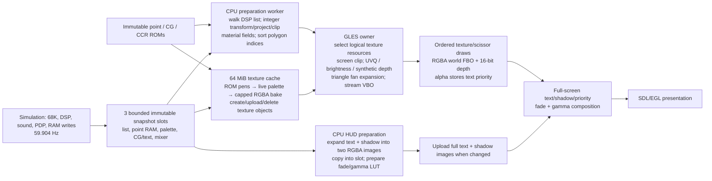

# Rave Racer ARM64 rendering architecture review

2026-10-14. Read-only investigation against HEAD `843ce2d`. No renderer changes,
builds, deployments or commits. Batching and texture-preparation experiments
remain disabled. The deployed executable still hashes to
`77536f56ad17de9cf8772175c73442d9cb246d87aeb6fbf6c8d7f07c3d6ab53e`.
EmulationStation remains running; no game was launched for this review.

## Recommendation

Prototype a **frame packet of exact texture views and already projected
primitives, backed by a bounded RGBA atlas**. Preserve the existing integer
geometry implementation. Follow with compact HUD state and updates instead of
two full-screen CPU images. These address substantial GLES-owner costs without
adding four-sampler selection or replacing proven projection arithmetic.

First test atlas sampling alone against preserved draws; then test submission
reduction. Do not authorize a complete renderer rewrite on the strength of draw
counts. GPU execution headroom is still insufficiently measured to promise
59.904 FPS. Direct GPU decoding of ROM pens is a second, higher-risk experiment.

## Existing architecture

### Translation details

* `rr_scene.c` preserves PDP frame eligibility and consumes direct polygons at
  emulated boundaries. Skipping presentation does not skip required board work.
* `slave_list.c` interprets viewport/zoom, Q15 view and object matrices, object
  shifts/flags, primitive references and priority information from polygon RAM.
  `geo_hw.c` reads ROM or point-RAM geometry, computes integer transforms,
  truncating projection and 1/16-pixel coordinates, clips and constructs quads.
  Sorting incorporates depth algorithms, explicit shifts and priority bands.
* `quad_gles2.c` retains screen coordinates. Its GL projection is a screen-to-
  clip matrix, not a new perspective camera. UVs carry U/Z, V/Z and 1/Z;
  fragments divide them. Brightness/64 multiplies sampled RGB. Solid objects
  obtain palette RGB on CPU. Each sorted polygon receives synthetic depth
  `0.9 - 1.8*(qi+1)/(count+1)`, independently of physical eye distance.
* `tex_bake.c` converts ROM tile addresses, flips/transpose and packed cmodes to
  pens, then applies the selected snapshot's palette. It produces nearest-
  filtered, clamped RGBA rectangles with guards and 256/512/1024 bake tiers.
  Palette generations invalidate bakes. Resident higher tiers are preferred:
  presentation/cache history affects selected resources and U/V scales.
* The current Rave table does not enable conditional Sys22 texture-map fixup.
  World CG/CCR data is immutable; HUD character RAM, tilemap, palette, scrolling
  and mixer state are dynamic. ROM-derived does not mean final RGBA is static.
* With original HUD enabled, blending is disabled for world rendering; the
  fragment shader discards zero-alpha texels and writes polygon priority into
  framebuffer alpha. The compositor suppresses text/shadow over priority-marked
  world pixels, applies integer-style shadow multiplication, then fade/gamma.
  The alternative path without the priority compositor enables alpha blending.

## Consistent timing evidence

The decomposition below uses **one preserved three-stage first-lap diagnostic**:
`/userdata/system/rave-racer-multicore/diagnostic-20261013-165148-22678`.
It uses parallel preparation, original HUD, ordered single-texture submission,
and `RR_PARALLEL_PREP_PROFILE`, `--profile-video`, `--thread-sync-profile` and
thread/stage CSVs. Batching and predecode are off. It covers ticks 1800–5639.
Local copies are `/tmp/rr-architecture-review/{diagnostic.log,presentations.csv,ticks.csv}`.
No earlier two-stage, batching or preload timings are inserted into this table.

| Scope | Measurement | Interpretation |
|---|---:|---|
| Simulation | 59.90458 Hz; 12.743 ms CPU/tick | Simulation work |
| Producer bookkeeping | 1.469 ms CPU/tick | Includes 0.787 ms snapshot copying; do not add copying again |
| CPU preparation | 14.590 ms CPU/picture | Independent worker; overlaps GLES |
| Original HUD preparation | 10.879 ms CPU/picture | Included above; decoder plus immutable image copies |
| List/decode/transform | 2.978 ms CPU/picture | Included in preparation |
| Sorting / direct geometry | 0.674 / 0.015 ms CPU/picture | Included in preparation |
| GLES owner | 21.924 ms CPU/picture | Entire presentation thread work |
| World draw scope | 16.017 ms wall/picture | Includes submission, texture work and vertex construction |
| Ordered submission | 10.441 ms wall/picture | Nested world scope; driver work and any driver waits |
| Draw-call wrappers | 7.696 ms wall/picture | Nested submission; not exclusive GPU execution |
| VBO upload | 0.302 ms wall/picture | Nested submission; one upload/picture |
| Texture lookup/decode | 1.832 ms wall/picture | World scope; pure decode approximately 0.507 ms |
| World texture upload | 0.535 ms wall/picture | World scope |
| HUD uploads | 4.790 ms CPU; 4.858 ms wall/picture | GLES-owner work; two full RGBA layers when dirty |
| Final composition | 0.872 ms CPU; 0.891 ms wall/picture | CPU submission cost, not shader execution time |
| Swap | 0.397 ms mean wall/picture | Median 0.142 ms; p95 0.552 ms |
| Draws / triangles | 863.8 / 1,822.7 per picture | About 2.1 triangles/draw |
| Streamed vertices | 218,719 bytes/picture | Existing frame VBO is already aggregated |
| Throughput | 42.432 FPS | Instrumented run; not a replacement for the five-pair ~41.28 FPS baseline |
| Image age | median 48.187; p95 63.144 ms | Snapshot publication to presentation |
| Presentation interval | median 23.303; p99 36.840; worst 82.500 ms | Same diagnostic CSV |

2720 presentations occur in the timed window; 2723 CSV/profile samples include
three drain pictures. Preparation p95 is 16.694 ms, already near the full-rate
budget. Audio output reports zero underruns/overruns; replay completed normally.
This is a preserved diagnostic, not a new five-run repeatability claim.

CPU and wall scopes overlap/nest. They cannot be added into a serial frame time
or used to calculate a combined atlas/HUD speedup. In particular, 10.441 ms of
submission is not measured as 10.441 ms of exclusive driver CPU work.

### GPU execution and pacing limits

This diagnostic has no reliable exclusive GPU execution/utilisation counter.
The later preserved query implementation brackets world rendering while CPU
feeds commands, decoding and uploading textures. Its elapsed span can include
GPU idle gaps and excludes final HUD composition. It cannot provide a clean
GPU-only budget or be combined with this diagnostic to predict FPS.

The existing multi-sampler experiment is evidence that shader cost matters,
not a timing component here: 76% fewer draws produced only 2.3% more racing FPS.
Its shader-only query results support additional shader cost, with the same
elapsed-span caveat. Predecode's five-pair result supports better hitch pacing,
not sustained throughput. Historical 34.48 FPS remains environmentally
unexplained; it is excluded from the architectural budget.

For a future authorized prototype, measure all options with one binary and
identical instrumentation on this replay. Use thread CPU scopes plus wall
timestamps; submit prepared world command chunks inside nonblocking disjoint
queries, and query composition separately. Those spans still are not active-GPU
utilisation; record feeding gaps, query disjoints and ring drops. Compare complete
presentation intervals as the final outcome. Do not insert `glFinish` into the
headline path or infer CPU/GPU savings by adding scopes from different runs.

## Principal inefficiencies

1. **Material storage determines draw granularity.** Thousands of logical bake
   rectangles become separate GL texture objects. The world VBO is already
   large, but texture switches split it into ~864 tiny draws. A bigger VBO alone
   addresses only the measured 0.302 ms upload, not the 10.441 ms submission.
2. **Reusable source data becomes repeated derived resources.** Overlapping UV
   rectangles, tiers and palettes duplicate immutable pens in RGBA allocations.
   Palette changes require rebakes; cache misses create/upload objects and clock
   evictions delete them. The same diagnostic records 7,652 uploads and 8,917
   evictions, with frame-end residency reaching the 64 MiB budget. This supports
   resource churn, not a conclusion that simply increasing the cache improves FPS.
3. **A small HUD change invalidates a large representation.** `rr_gl_video_cpu`
   compares complete CG/text state and rebuilds all pixels when any input changes.
   `rr_gl_video_prepare` copies both 640×480×4 images even when their generation
   has not changed. `rr_video_layers_compose` uploads both complete images on a
   generation change: 2,457,600 bytes/update. This accounts for substantial CPU
   preparation and GLES-owner CPU costs, independently of world draw count.
4. **Dynamic geometry is represented as expanded CPU polygons.** Object/list
   parsing and static ROM material/UV information are revisited each picture;
   clipped fans duplicate vertices. Projection reuse currently avoids a second
   projection of vertices when no near clipping is necessary, not an enduring
   GPU model cache. The measured 2.978 ms list/transform and 0.674 ms sorting
   limit the return from tackling this first. Genuine dynamic transforms, point
   RAM, clipping and priority must still be computed correctly.

## What actually needs ordering?

Keep emulated PDP/list/direct-FIFO consumption and palette/texture updates in
their correct simulation order. Resource selection must follow the current
request sequence to preserve sticky tiers and scales. Deletion or overwriting
storage referenced by queued draws is a real barrier.

World **submission order** has more freedom when the original compositor is
enabled: depth test is LEQUAL, depth writes are on, blending is off, and synthetic
depth encodes sorted priority. Opaque polygons at distinct representable depths
can potentially be regrouped while retaining their assigned depth. Discarded
texels still expose the correct lower polygon. Framebuffer alpha belongs to the
depth-winning polygon and must retain its HUD priority value.

This is a candidate rule, not a validated reordering proof. Preserve triangle
order within each polygon; retain stable order for depth ties/quantisation
collisions in the **16-bit world FBO**, overlapping fan triangles, and any
blended path. Preserve scissor state. Never substitute physical eye-Z for the
synthetic rank. A globally sorted-by-texture implementation without these
conditions would be unsafe.

The preserved free-running tick-2500 manifest contains 1,328 polygons, 669
distinct texture views, 259 allocation shapes and only two scissors (1,251 full
screen; 77 rear-view region). Their unique allocation payload is 25,979,756
bytes, about 24.8 MiB. Texture/scissor regrouping alone still yields 675 groups.
These are representation statistics from one captured picture, **not** timings
or proof that every first-lap picture fits an atlas. Atlas fragmentation and
in-flight retired views need separate bounds.

## Redesign options and smallest prototypes

### 1. Exact RGBA texture views in bounded atlas pages — recommended world path

Walk primitives in the original resource-selection order. Record immutable
views containing the exact bake tier, allocation/guard shape, scales, palette
generation and atlas location. Emit current screen-space geometry into a frame
packet. Adjacent primitives sharing a page/scissor can be drawn together in
original order using one sampler. After proof of depth-order independence,
group opaque packets by page/scissor for further reduction.

**Advantages:** one texture sample, no four-sampler branch; fewer bindings and
draws; persistent page storage instead of object creation/deletion per bake.
Retains validated CPU projection, brightness, priority and texture decoder.
Packing CPU uploads into contiguous scratch rectangles works on GLES2 without
desktop `UNPACK_ROW_LENGTH`. Existing desktop atlas allocation policy is too
large and must not be enabled unchanged.

**Complexity:** medium to high. Need a bounded allocator, logical cache separated
from physical storage, view lifetime management and packet construction. The
64 MiB bound must include retired/pinned regions rather than silently growing.
Atlas coordinates require per-primitive rectangle metadata.

**Risks:** nearest-sample rounding when relocating normalized UVs; clamp/guard
behaviour; fragmentation; premature reuse of an in-flight region; changed
eviction history causing different selected tiers. Do not globally preselect
higher tiers, replace the sticky policy, or assume placement leaves pixels
unchanged. Logical cache events can retain their order while physical views
remain pinned, but both memory and policy require explicit verification.

**Smallest prototype:** use the preserved tick-2500 draws and exact RGBA
resources, preserving the original UVQ interpolation and both scissors. Pack
into bounded pages and render with the original polygon order. Require zero
RGBA differences before combining draws. Test nearest boundaries and both
978/1351 resource tiers. Then compare ordered page groups and depth-safe page
groups with the same shader and resources. Measure complete world/compositor
GPU spans and submission CPU. Do not start by rebuilding model geometry.

GLES3 integer addressing or texture-array pages can simplify rect addressing.
Arrays do not remove packing problems automatically: all layers share dimensions,
while this capture has 259 shapes. Padding every bake to 1024² would waste the
budget. A layer coordinate avoids conditional sampler selection, but changing
logical allocation sizes still requires exact sampling validation.

### 2. GPU-resident ROM pens, tile indirection and live palette

Store immutable oriented pen tiles plus a map from ROM tile positions to those
tiles. Upload the current palette independently. Supply each primitive's original
logical bake dimensions, origin, steps and cmode so the shader samples exactly
the texel its selected bake would have contained. Keep a metadata-only logical
cache if necessary to preserve existing tier/history semantics.

The complete-ROM diagnostic established 65,747 oriented tiles and a 32-bit
1,048,576-entry map, approximately 20.05 MiB total source data. This is a credible
bounded source representation; GPU padding/format allocation must be counted
separately. A 256×128 RGBA palette is another 128 KiB. Source decoding is done
once; palette updates no longer require rebaking world RGBA images.

**Advantages:** eliminate normal world bake/upload/delete churn and most material
bindings; keep the original primitive order in large draws. Particularly promising
for first-use hitches and dynamic palettes. No race-specific worklist is required.

**Complexity:** high. GLES3 integer textures, bit operations, flat metadata and
`texelFetch` make this considerably cleaner than GLSL100 float emulation.

**Risks:** extra dependent map → pen → palette reads and per-fragment decoding may
move the bottleneck to the Mali GPU. This uses several fixed samplers, not one
physical sampler, but avoids selection among many material samplers. It must
reproduce packing, source wrap, invalid tile pen zero, decimation, guards,
opacity and old nearest selection exactly. Choosing full-resolution ROM sampling
would change current pixels. GPU projection is not needed for this option.

**Smallest prototype:** reproduce the preserved failing surface and full frozen
scene using GPU pen/map/palette resources, initially retaining original draw
boundaries. Test shader pixels and GPU cost first. Only after that gate, encode
metadata per triangle and merge ordered draws. Reject it if shader cost consumes
the submission saving. CPU source verification already exists but does not
establish shader pixel equivalence.

### 3. Compact HUD state with a GPU tilemap compositor

Retain original tilemap/CG RAM and palette indices in GPU textures. Upload changed
state, then resolve glyph, transparent pen, shadow pen, scrolling and priority in
the final composition pass. Reuse the current world-alpha priority contract and
integer fade/gamma rules. An intermediate lower-risk prototype can keep CPU
expansion but use dirty tiles/regions and separate text/shadow generations.

**Advantages:** avoids full-screen CPU expansion/copies and multi-megabyte HUD
uploads for a few changed characters. Addresses the 10.879 ms preparation scope
and 4.790 ms GLES-owner upload CPU scope from the same diagnostic. This can add
full-rate preparation headroom as world submission becomes faster.

**Complexity:** medium for dirty region updates; high for GPU tilemap composition.
Preserve dirty state against the **last uploaded generation**, not the last
prepared picture, because pictures can be discarded. Character addressing can
read bytes from text RAM beyond the CG region; treating all glyph data as ROM
would be incorrect.

**Risks:** extra compositor texture reads; exact shadow multiplication and gamma
rounding; scroll/flip/mixer dependencies; dropped-slot updates; character/palette
changes. Disabling or approximating the original HUD is not an acceptable gain.

**Smallest prototype:** replay captured HUD snapshots against a frozen world FBO,
with scrolls, flipped tiles, shadow pens FC–FE, priority alpha and palette changes.
Compare final RGBA exactly. Include discarded intermediate snapshots. Measure
preparation, upload CPU and compositor GPU span together. Dirty CPU regions are
a useful fallback if the direct GPU compositor is too expensive.

## Geometry buffers and API choice

A cached ROM model representation could avoid repeated static topology/material
parsing and UV-bound computation. Key ROM objects by validated source identity;
invalidate point-RAM recipes by revision. Continue integer transforms, projection
and clipping. Reuse compact topology or indices where clipping permits. This
can accompany a frame packet, but is not the first sustained-FPS experiment:
the VBO is already aggregated and preparation is not the largest mean stage.

Moving transforms entirely to floating-point GPU vertex shaders is substantially
riskier. Current geometry deliberately uses signed division, Q15 arithmetic,
saturation and wide integer clipping. Ordinary perspective/depth/Gouraud
interpolation is not a substitute for that contract. GLES2 also lacks core
instancing, integer attributes and texture arrays. Those limits do not prevent
an RGBA atlas or compact projected geometry packets.

The deployed log reports OpenGL ES 3.2 / GLSL ES 3.20, max texture 8192 and
fragment highp precision 23 bits. Thus GLES3 is a realistic backend candidate,
subject to an actual requested-context/capability smoke test. Its integer
textures/attributes, texture arrays and shader integer operations are specified
by [Khronos ES 3.0](https://registry.khronos.org/OpenGL/specs/es/3.0/es_spec_3.0.pdf).
An API upgrade alone does not remove bad material representation or driver work.

Arm lists GLES3.2 and Vulkan support for
[Mali-G31](https://support.arm.com/compute-ip/mali-g31), but hardware support is
not proof of the installed firmware's Vulkan stack. Device inspection found a
Vulkan introspection typelib, not a Vulkan loader/ICD or `vulkaninfo` in the
checked library paths. Vulkan is therefore not currently established as a viable
deployment option. A driver/firmware migration would greatly enlarge this task;
it is not justified before atlas/HUD prototypes answer the architecture question.
Current GPU devfreq reads 240 MHz with several higher available frequencies;
no clock/governor change was made and advertised frequencies are not benchmark
conditions or a renderer speedup estimate.

## Is sustained 59.904 FPS realistic?

The target budget is 16.693 ms. From this one diagnostic, the GLES owner must
remove **at least 5.231 ms of CPU per picture**, about 24%, before even its mean
CPU work fits. Scheduling, feeding and GPU completion need additional headroom.
Preparation p95 already reaches the budget; simulation plus producer work uses
about 14.212 ms CPU/tick. The four-core CPU has room to overlap the stages, but
the critical serial GLES work and GPU budget must both fit.

This makes 59.904 FPS **plausible as a redesign target, not demonstrated or
predictable from existing evidence**. An atlas plus compact HUD attacks costs
large enough to matter while avoiding extra world sampling. Peak scenes and
first-use allocation/upload bursts may still prevent sustained full rate. A
new GPU ROM shader could also erase the CPU benefit, just as the multi-sampler
experiment partly did. No defensible narrow FPS forecast is available yet.

The decision gate is exact pixels/resources/state first, then one consistent
first-lap comparison including image age, p99/worst interval, audio and simulation.
For sustained full rate, evaluate deadline misses across dense geometry, rear
view, original HUD, dynamic palettes and first loading, not just median FPS.
Authorize small frozen-scene prototypes before a substantial development effort.
