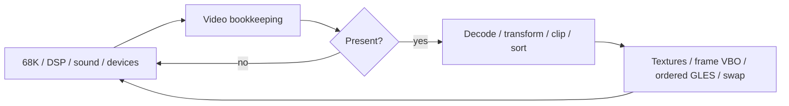
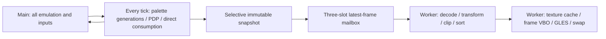

# Experimental concurrent simulation and presentation

## Status and decision

`RR_THREADED_PRESENTATION` is an opt-in GLES2 architecture experiment, **OFF by
default**. The original single-threaded path remains available in the same
executable with `--presentation-thread off`, and in a build with the option OFF.
No game logic, DSP/sound timing, geometry arithmetic, texture policy, shaders,
or ordered GLES commands have been changed. No CPU affinity is imposed.

Measurements and validation below refer to the physical RG40XX H, Knulli
Scarab's SDL `mali` driver, H700 Buildroot SDK, 640x480, original textures and a
64 MiB GPU texture budget. The three validated presentation optimisations and
the validated WRAM/split-reader/C352 optimisations are explicitly enabled.
The experimental executable is separate from the working `rr_gles2`.

The reviewed build's five alternating dense-opening pairs measured **26.07 ->
57.52 FPS (+120.6%)**, with **59.90 simulation Hz**, zero resynchronisations,
matching pixels/audio/state and approximately 9.36 MiB measured RSS overhead.
It remains experimental: no real controller-play/listening test was performed,
and neither workload proves sustained 59.904 rendered FPS across gameplay.

## Original execution model

The translated 68K program calls the cooperative scheduler (`rr_poll`) after
exhausting its budget. Sixteen slices make one emulated frame. Slices run the
native C25 DSP, translated C74 sound program/peripherals, C352 sample generation
and serial pulses. Frame boundaries advance video/PDP bookkeeping, then service
board inputs/ADCs, IRQ dispatch and translated handlers. These operations and
the memory helpers share mutable board state and remain on **one simulation
thread**, in their original order.

In the previous independent-timing path, that same thread waits to the existing
host-clock deadline and decides whether to present. `rr_gl_prepare_gles2`
updates palettes and video bookkeeping even on skipped frames; selected frames
also decode direct polygons and traverse the System 22 display list, decode
point data, apply original fixed-point transformations, project/clip and sort.
`eng_gles2_draw` expands ordered polygons into triangles, resolves/decodes/uploads
textures, builds the existing contiguous frame VBO, submits ordered commands
and swaps the window. Simulation cannot execute during any of that work.

The dense opening previously required roughly 9.5 ms core simulation per tick
plus approximately 16.2 ms presentation per displayed frame. A single main
thread cannot pay both costs at 59.904 ticks AND presentations/sec. Independent
timing prioritises ticks and drops pictures; its low FPS is not evidence that
the GPU is saturated.



## Threaded execution and ownership

The original/main thread becomes the simulation producer. A pthread owns
presentation. This preserves SDL window creation/event pumping on the original
thread and avoids moving translated game execution or its diagnostics.



| Data / operation | Owner and handoff |
|---|---|
| 68K registers, WRAM, shared RAM, IRQ/device/sound/C352 state | Simulation only; never read by worker |
| PDP begin/refresh flags, direct-polygon FIFO, video frame counter | Simulation only; `rr_scene_frame` and `rr_scene_consume` execute once every tick |
| Polygon RAM, DSP point RAM, palette planes, mixer, depth-cue RAM | Copy into a reserved snapshot while simulation is paused at its original video boundary |
| Direct polygons | Copy current FIFO before consuming it, including frames omitted from presentation |
| Palette generations | Simulation-owned private ledger, updated **every tick**; generations travel with raw palette data |
| Point/texture ROMs and decoded static tilemap | Read-only sharing after asset initialisation; no copies per frame |
| Scene/view state, polygon buffer and sorted indices | Worker only |
| Converted palettes, texture metadata/scratch/GPU cache | Worker only |
| GLES program, streaming VBO, ordered commands, context | Worker only after one-time context transfer |
| SDL controller handles/events and latched coin/START edges | Main only; applied at original emulated input boundary |
| End-of-run state/audio diagnostics | Simulation records state; worker joined before graphics/profile cleanup |

### Snapshot extent and memory

The snapshot contains no simulation pointers:

| Field | Bytes per slot |
|---|---:|
| Polygon RAM | 131,072 |
| DSP point RAM | 524,288 |
| Raw RGB palette planes | 98,304 |
| Mixer RAM | 32,768 |
| Depth-cue RAM | 32,768 |
| Direct polygons: capacity 4096 x 28 words | 229,376 |
| Palette generations and frame metadata | 280 |
| **Total** | **1,048,856** |

Three slots allocate **3,146,568 bytes once**, before execution. The 96 KiB
palette ledger and bounded 8192-record diagnostic array add fixed storage.
Only live direct FIFO entries are copied, not its maximum capacity. There are
no per-frame snapshot allocations and no copies of the full emulated machine.
The whole point-RAM window is conservatively copied because list decoding can
indirectly reference it. Further selective point-RAM tracking is outside this
experiment. Typical raw copies are about 0.8 MiB/published tick; at 60 Hz this
is tens of MiB/sec, so its measured CPU/cache cost must be included.

Text RAM/character RAM are not captured: the current GLES2 port excludes the
HUD/text layer. Adding that feature must extend the immutable boundary before
its renderer may read those mutable fields. The snapshot is not a general
purpose save-state or a GPU-resource mutation stream.

### Mailbox and dropping frames

Slots transition `FREE -> WRITING -> READY -> READING -> FREE`. A mutex/condition
protects **metadata and ownership**, not the rendering interval. The producer
fills its exclusively reserved slot outside the lock; mutex publication makes
all writes visible. It can replace the oldest READY snapshot, never the READING
slot. The consumer chooses the newest READY snapshot and frees older READY
work. Queue size is bounded; neither thread retains pointers after releasing
ownership. No global emulation lock is held during rendering or swap.

PDP processing, DSP execution, FIFO consumption and interrupts are not deferred.
The next snapshot is a complete description of its selected frame's required
video state, not a stale geometry buffer or a delta that depends on every prior
picture. The private palette generation ledger carries changes across skipped
or replaced snapshots, including change-then-revert transitions. Texture ROMs
are immutable; texture decoding/upload is on demand from the snapshot palette.
Existing texture mutation barriers and ordered submission are unchanged.
Dropping a snapshot therefore cannot lose a persistent palette/resource update.

### Timing, input, context and shutdown

The host period is unchanged: `814 * 525 / 25,600,000` seconds, or
**59.904059904 Hz**. Existing bounded catch-up/resync policy is reused, without
changing an emulated clock, IRQ rate or sample count. Simulation does not wait
for the consumer during normal execution. Input polling continues at every tick
and at 1 ms sleeps while waiting for deadlines. Existing edge queues preserve
coin/START DOWN+UP events between emulated samples. START+SELECT still exits.

The SDL window/context and graphics resources initialise on main. Main detaches
the context; worker attaches it and reports startup success before execution.
Worker alone calls GLES and `SDL_GL_SwapWindow`. On shutdown producer closes the
mailbox, consumer finishes bounded pending work, detaches and exits. Main joins,
reattaches only for graphics destruction, then closes controller/window/SDL.
Fatal simulation exits also join/clean up before process exit. There is never
a context current on both threads. No `glFinish`, cross-thread GL objects,
fences, GPU uploads on main or unconditional GPU synchronisation are added.

There is no existing GLES pause-menu or in-process emulator restart; this change
does not add them. An idle consumer waits on the condition variable. Repeated
startup/execution/exit is tested as separate processes, as used by Ports.
GLES audio playback was already disabled: sound CPU and C352 still execute and
are checked, but this task cannot claim listening tests or audible continuity.

## Profiling and comparison semantics

Legacy shared `--profile-stages`, pipeline audit and SIGPROF sampling are rejected
in threaded mode; their process-wide scope stacks are not safe for concurrent
owners. `RR_PIPELINE_AUDIT` must be OFF for this build. Optional `--thread-sync-profile` measures metadata-lock acquisition (including
clock overhead) and condition-variable idle time, per owner. It is disabled by
default; these whole-run diagnostics are separate from headline measurements.
The original main-only `--profile-simulation` is available for separate detailed runs. Headline runs
exclude its stage clocks and other expensive diagnostics.

`[THREAD-RATE]` reports the inclusive simulation-frame range from `--profile-from`
to termination. It uses one monotonic interval for simulation Hz and completed
presentations/sec. Presentations completed during shutdown drain are reported
separately and **excluded from FPS**. The core simulation CPU average excludes
the producer callback; `[THREAD-DETAIL] producer_cpu_ms` includes bookkeeping,
input and snapshot copy. `copy_cpu_ms` is a subset, not an additional cost.
Presentation CPU includes geometry, backend and swap calls; `scene_wall_ms` is
an inclusive subset. GLES coarse stage times remain wall-clock times, including
possible driver blocking, not a GPU timer or pure CPU cost.

The legacy `[PROFILE] simulation=0.000` field is unmeasured in snapshot modes,
not zero simulation cost; use `[THREAD-RATE]` plus producer CPU instead.

`cpu_cores_equivalent` sums thread CPU over the same wall interval (with a small
bounded drain-tail endpoint error). Values greater than one, corroborated by
per-thread/per-core `/proc` samples, demonstrate actual overlap. CSV records
include frame, start/end, thread CPU, scene wall, publication-to-swap-return age,
age in simulation ticks, and ending core. Storage is bounded at 8192 records;
aggregate totals continue afterward and overflow is reported. CSV is written
only after join, not per frame. Publication age is **not panel scanout latency**.
Input-to-publication time and driver/display buffering are additional.

The benchmark monitor samples `/proc/stat`, process task statistics, CPU/GPU
frequencies and thermal nodes at 1 Hz for both variants. Per-core utilisation
includes system/driver work. Task CPU and migration observations identify
application threads; a final sampled core does not prove continuous affinity.
No core pinning is used. Reliable Mali GPU occupancy/timer counters are not
available, so no GPU saturation percentage is claimed.

The two workloads use the same deterministic script: coin frame 180, accelerator
frame 200, steering 2304 at frame 300 and 2048 at frame 700. The dense opening
1400..1700 (301 ticks) is primary. The extended 1400..3600 (2201 ticks) includes a
wall-facing stationary tail and is **not representative racing FPS**. The queue
changes which pictures get presented; headline render counts are not forced to
match. Correctness instead uses `--test-present-every 3` and capture checkpoints
to compare identical pictures. That mode waits for consumption and is never
used to claim concurrent performance.

## Files

- `include/rr_presentation.h`: immutable video payload and boundary API.
- `src/rr_presentation.c`: palette ledger, bounded mailbox, worker, clock and metrics.
- `src/rr_dsp.c`: simulation-owned point-RAM copy helper.
- `src/rr_gl.c`: snapshot-backed video reads and the unchanged geometry pipeline.
- `src/rr_main.c`: opt-in video handoff; cooperative emulation remains unchanged.
- `src/rr_gles2.c`: options, context transfer, worker presentation/capture path.
- `src/rr_headless.inc`: experimental fatal cleanup/help; headless behaviour unchanged.
- `CMakeLists.txt`: default-OFF switch and pthread linkage, GLES2 target only.
- `tools/test_threaded_presentation.py`: baseline/snapshot/thread/drop correctness.
- `tools/RaveRacer-Threaded-Benchmark.sh`: alternating comparisons and monitoring.
- `tools/RaveRacer-Threaded-Profile.sh`: serial snapshot and separate stage/lock controls.
- `tools/analyse_threaded_benchmark.py`: state validation, rates, CPU/latency distributions.
- `tools/test_presentation_palette.c`: ledger equivalence including reverted updates and wrap.
- `tools/RaveRacer-Threaded-Correctness.sh`: same-GPU ARM64 checkpoint matrix.
- `tools/RaveRacer-Threaded.sh`: separate interactive Ports launcher.

## Build and deploy

From repository root, using an isolated build directory:

```sh
export KNULLI_HOST="$HOME/dev/knulli-scarab/output/h700/host"
cmake -G Ninja -S raverace -B /tmp/rr-thread-build-arm64 \
  -DCMAKE_BUILD_TYPE=Release \
  -DCMAKE_TOOLCHAIN_FILE="$PWD/raverace/cmake/knulli-aarch64.cmake" \
  -DRR_GLES2=ON -DRR_THREADED_PRESENTATION=ON \
  -DRR_ORDERED_SUBMISSION=ON -DRR_GEOMETRY_INDEX_ORDER=ON \
  -DRR_GEOMETRY_REUSE_PROJECTION=ON \
  -DRR_FAST_MEMORY_READS=ON -DRR_SPLIT_MEMORY_READER=ON \
  -DRR_C352_INACTIVE_FASTPATH=ON -DRR_PIPELINE_AUDIT=OFF
cmake --build /tmp/rr-thread-build-arm64 -j4
file /tmp/rr-thread-build-arm64/rr_gles2
"$KNULLI_HOST/bin/aarch64-buildroot-linux-gnu-readelf" -d \
  /tmp/rr-thread-build-arm64/rr_gles2
scp /tmp/rr-thread-build-arm64/rr_gles2 \
  root@192.168.1.69:/userdata/roms/ports/rave-gles2/rr-thread-final-arm64
scp raverace/tools/RaveRacer-Threaded.sh \
  root@192.168.1.69:/userdata/roms/ports/RaveRacer-Threaded.sh
ssh root@192.168.1.69 'chmod +x /userdata/roms/ports/rave-gles2/rr-thread-final-arm64 /userdata/roms/ports/RaveRacer-Threaded.sh'
```

Reuse existing `extracted/` ROMs. Do not replace `rr_gles2` or its launcher.
Select **RaveRacer-Threaded** under EmulationStation Ports; refresh the game
list if the new entry is missing. Runtime log:
`/userdata/roms/ports/rave-gles2/rave-threaded.log`. Normal controller mapping
is unchanged. To compare original execution in the experimental binary:

```sh
./rr-thread-final-arm64 extracted --interactive --presentation-thread off \
  --timing independent --skip-geometry-on-dropped-frames on \
  --texture-budget-mib 64 --vbo-upload frame
```

For reproducible A/B tests, build a second directory with the same settings
except `-DRR_THREADED_PRESENTATION=OFF`, deploy its binary as
`rr-thread-reference-arm64`, then:

```sh
scp raverace/tools/RaveRacer-Threaded-Benchmark.sh \
  root@192.168.1.69:/userdata/roms/ports/rave-gles2/
ssh root@192.168.1.69 'cd /userdata/roms/ports/rave-gles2 && chmod +x RaveRacer-Threaded-Benchmark.sh && RR_THREAD_BINARY=./rr-thread-final-arm64 ./RaveRacer-Threaded-Benchmark.sh'
```

The runner saves separate JSON/log/CSV/monitor/exit files, verifies unchanged
executable hashes and identical state within each workload, stops the frontend
for direct fbdev access and restores it in its exit trap. Do not run two Mali
clients simultaneously. Result interpretation must exclude the short startup
and shutdown periods and distinguish independent timing from fixed-frame tests.

## Correctness procedure

A native build uses the same flags without the toolchain argument. For complete
texture-event checks add `-DRR_GLES_SUBMISSION_PROFILE=ON` in a **separate
validation build**; its detailed timers stay off unless their environment option
is explicitly enabled. Then:

```sh
SDL_VIDEODRIVER=offscreen MESA_GLES_VERSION_OVERRIDE=2.0 \
  python3 raverace/tools/test_threaded_presentation.py \
  /tmp/rr-thread-validation-native /tmp/rr-reader-headless-split/rr_headless \
  raverace/extracted /tmp/rr-thread-validation
```

The test checks 600/1700/3600, baseline mutable-memory rendering, serial snapshot
rendering, threaded fixed presentations and free-running latest-frame dropping.
Same GPU is required for byte-perfect screenshots. It compares JSON state,
PCM/voice state, board/video bookkeeping, ordered full polygon records and pixels.
Full texture-event streams must match for fixed presentation sequences; dropped
sequences legitimately access the cache differently and are not compared as if
they were the same workload. A capture forces/waits for its own snapshot so an
obsolete frame cannot replace that checkpoint.

ThreadSanitizer build (native, separate directory, no headline measurements):

```sh
cmake -S raverace -B /tmp/rr-thread-tsan -DRR_GLES2=ON \
  -DRR_THREADED_PRESENTATION=ON -DRR_ORDERED_SUBMISSION=ON \
  -DRR_GEOMETRY_INDEX_ORDER=ON -DRR_GEOMETRY_REUSE_PROJECTION=ON \
  -DRR_FAST_MEMORY_READS=ON -DRR_SPLIT_MEMORY_READER=ON \
  -DRR_C352_INACTIVE_FASTPATH=ON -DRR_PIPELINE_AUDIT=OFF \
  -DCMAKE_C_FLAGS='-fsanitize=thread -g' \
  -DCMAKE_EXE_LINKER_FLAGS=-fsanitize=thread
cmake --build /tmp/rr-thread-tsan -j4
SDL_VIDEODRIVER=offscreen MESA_GLES_VERSION_OVERRIDE=2.0 \
  TSAN_OPTIONS=halt_on_error=1 /tmp/rr-thread-tsan/rr_gles2 \
  raverace/extracted --frames 1700 --coin 180 --gas 200 \
  --steer 300:2304 --steer 700:2048 --timing independent \
  --skip-geometry-on-dropped-frames on --texture-budget-mib 64 \
  --audio-checksum-from 1 --capture-frame 1700 --capture /tmp/thread-tsan.ppm
```

TSan checks instrumented application accesses, not the uninstrumented proprietary
Mali driver. Physical context handoff, repeated execution, real cache updates
and shutdown tests complement it. Real handheld controller play and panel/audio
latency still require user testing; checksum equivalence is not a listening test.

## Physical results (12–13 October 2026)

Three sequential hardware sessions were used; no two framebuffer clients ran
concurrently. The first matrix used the functional prototype; after readability,
error-reporting and optional lock-profiling review, a second five-pair dense
matrix measured the final uninstrumented build. Both have all validated flags
ON. Detailed stage/lock profiling was a separate session. Native and handheld
correctness ran separately from headline performance.

Artifacts remain on the device under `/userdata/roms/ports/rave-gles2/`:

- `threaded-benchmark-20261012-233014-526`: five alternating pairs, each workload.
- `threaded-correctness-20261012-234546-18002`: twelve Mali reference/snapshot/thread/drop cases and headless references.
- `threaded-benchmark-20261012-235344-18753`: five final-build dense pairs.
- `threaded-profile-20261012-235843-24718`: serial-snapshot control and separate stage/lock runs.

Host copies are in `/tmp/rr-thread-h700-results/`. Each result directory includes
logs, JSON and executable hashes; performance directories also contain CPU
monitors, bounded render timelines and exit codes. Analyse a complete directory:

```sh
python3 raverace/tools/analyse_threaded_benchmark.py /tmp/rr-thread-h700-results/threaded-benchmark-20261012-235344-18753
```

### Headline dense opening: final build, five alternating pairs

Medians of per-run results; ranges are minimum..maximum. Checkpoint drain is
excluded from FPS, and simulation/render rates use the same 301-tick interval.

| Metric | Single-thread reference | Threaded | Interpretation |
|---|---:|---:|---|
| Simulation Hz | 58.646 (58.453..58.687) | 59.904 (59.897..59.913) | Target within endpoint/clock quantisation |
| Rendered FPS | 26.072 (25.735..26.322) | 57.518 (57.510..57.713) | Median paired change **+120.60%**, every pair positive |
| Pictures completed in measurement window | 134 median | 289 median | Two additional threaded pictures typically drain after stop |
| Scene preparation wall ms/presentation | 3.254 | 3.491 | No claim of cheaper per-picture geometry |
| GLES submission wall ms/presentation | 6.653 | 7.191 | Includes VBO, draw calls and remaining submission calls |
| `glDrawArrays` subset wall ms/presentation | 5.258 | 5.605 | Same GLES architecture |
| Swap wall ms/presentation | 0.480 | 0.861 | Driver/display timing, not GPU occupancy |
| Draws/presentation | 791.9 | 798.9 | Different selected-frame mix; equivalent-frame counts/records match |
| Triangles/presentation | 1909.4 | 1924.5 | Geometry/order unchanged |
| Binds/presentation | 794.9 | 800.7 | No batching/state optimisation in this experiment |
| Timing resyncs | 2..3 | 0 in every run | Same clock/catch-up policy |
| Discarded lag ms | 104.985 median | 0 | No emulated frames discarded |
| Queue-dropped snapshots | n/a | 10 median (9..10) | Bounded latest-frame policy |
| Peak READY depth | n/a | 2 | Three total slots including active reader/writer |
| Core simulation CPU ms/tick | See separate stage run below | 10.707 | Excludes producer video/input bookkeeping |
| Producer CPU ms/tick, including copies | n/a | 1.009 | Simulation-side total approximately **11.716 ms/tick** |
| Snapshot copy CPU ms/tick (subset) | n/a | 0.455 | Almost every tick publishes in this window |
| Presentation thread CPU ms/picture | See control below | 15.853 | Median individual picture 15.734; p95 20.345 |
| Application CPU cores equivalent | approximately one | 1.617 | Genuine concurrent CPU execution |
| Process RSS KiB | 203,392 | 212,976 | +9,584 KiB (~9.36 MiB), includes driver/thread/allocator effects |
| MemAvailable KiB | 584,960 | 575,532 | No measured memory pressure or allocation failures |

Paired FPS gains: **123.50%, 120.60%, 119.42%, 118.55%, 121.00%**. The original
prototype's additional five pairs gave 26.258 -> 57.314 FPS (+117.99% median
paired gain). The reviewed build therefore confirms, rather than reverses, the
architectural effect. Do not compare historical ~27 FPS or ~23.65 FPS runs as
if they were simultaneous controls; these fresh alternating runs are the result.

Coarse rendering subsets in the final threaded matrix: lookup/decode 1.529 ms,
texture upload 0.336 ms, remaining backend/triangle/command construction 2.872 ms,
vertex transfer 0.251 ms (already inside submission), one contiguous upload per
picture, approximately 230,938 vertex bytes/picture. GPU texture storage remains
below the existing 67,108,864-byte budget. Ranged GPU uploads were 235 in each
threaded run versus 235..259 in baseline runs. More frequent pictures can alter
cache revisit/eviction patterns without changing the policy; unlike fixed-frame
correctness, these are not identical cache-event schedules.

CPU monitors corroborate overlap. Median per-core busy percentages were
approximately **50.3 / 41.8 / 31.7 / 58.3%** threaded versus
**69.0 / 26.6 / 10.5 / 9.3%** reference in the final session; main migrates, so
no individual core is a permanently assigned simulation/render core. One
representative threaded window reports main **70.0% of one core**, `rr-present`
**91.0%**, and Mali CMA/backend thread **6.2%**. The reference application's main
was approximately 98.4%. Baseline monitoring uses a last-window endpoint proxy
because its older log has no absolute monotonic start/end; threaded monitoring
uses explicit endpoints. These are utilisation observations, not PMU counters.

Across the two complete matrices, sampled CPU frequencies were 1.2..1.512 GHz,
with active periods commonly at 1.512 GHz. Highest sampled temperature was
approximately 57.8 C; there was no observed sustained maximum-frequency collapse.
This does not establish the absence of all thermal/governor effects. Alternation
and narrow repeat ranges provide better protection than assuming constant clocks.

### Extended drive/wall tail: five prototype pairs

| Metric | Single-thread | Threaded |
|---|---:|---:|
| Simulation Hz | 59.551 (59.435..59.605) | 59.904 (59.904..59.905) |
| Rendered FPS | 45.386 (44.934..45.482) | 58.843 (58.815..58.897) |
| Median paired FPS change | — | +29.67% |
| Core simulation CPU ms/tick | — | 10.951 |
| Producer CPU ms/tick, including copy | — | 0.940 |
| Copy CPU ms/tick (subset) | — | 0.421 |
| Presentation CPU ms/picture | — | 9.879 |
| Scene wall ms/picture | 2.208 | 2.647 |
| Submission wall ms/picture | 2.868 | 3.819 |
| Swap wall ms/picture | 0.907 | 6.943 |
| Application CPU cores equivalent | approximately one | 1.296 |
| Queue-dropped snapshots | — | 37 median (35..38) |
| Resyncs / discarded lag | — | 0 / 0 in every run |
| Process RSS KiB | 236,168 | 241,776 |

This window's lighter wall-facing tail lets the worker spend much more time
waiting in swap/presentation instead of active CPU preparation. Different
presentation selection weights the heavier and lighter frames differently:
mean draws are 316.1 reference versus 394.4 threaded, so a raw per-picture stage
comparison is not matched scene complexity. The exact checkpoint comparisons
establish rendering correctness. **58.84 FPS here is not representative moving
race performance.**

### Serial snapshot control and separate CPU-stage profiling

Running the same snapshot decoder **on the original thread**, without any worker,
gave 58.456 simulation Hz, **25.635 FPS**, and 0.996 CPU cores equivalent. Its
presentation CPU was 15.548 ms/picture and scene preparation 3.191 ms. Snapshot
representation/pacing alone therefore did not cause the approximately 57.5 FPS
result. The gain is overlapping two substantial streams of CPU work, not an
artificial increase in simulation rate or a cheaper substitute renderer.

Exclusive emulation-stage **wall** timings, one detailed dense run per variant:

| Simulation component | Reference ms/tick | Threaded ms/tick |
|---|---:|---:|
| Translated 68K, including memory/I/O | 4.003 | 4.318 |
| DSP, including hardware PDP | 2.262 | 2.644 |
| Sound CPU/peripheral bus | 2.065 | 2.291 |
| C352 mixing | 1.125 | 1.145 |
| IRQ dispatch/translated handlers | 0.269 | 0.307 |
| Scheduler | 0.031 | 0.037 |
| Serial and board I/O | 0.006 | 0.007 |
| Overall simulation wall | 9.761 | 10.749 |
| Overall simulation thread CPU | 9.735 | 10.681 |
| Median / p95 simulation CPU | 9.573 / 11.002 | 10.650 / 11.787 |

Stage costs did not improve: shared-cache/bandwidth contention is plausible,
but no reliable PMU measurements quantify it. The single detailed pair is not
a separate speedup claim. Importantly, the main simulation plus approximately
1 ms producer work still fits its 16.6936 ms period and does not wait for GLES.

Optional lock diagnostics over **all 1700 ticks**, not just the measured ROI:
producer 5102 acquisitions cost 2.525 ms total (~**1.49 microseconds/tick**),
maximum individual acquisition 15.708 microseconds. Consumer 4703 acquisitions
cost 1.508 ms total, maximum 3.375 microseconds. Producer condition waiting was
0.122 ms total for startup handshake; **no per-tick renderer barrier** occurred.
Consumer condition idle was 6.033 seconds, largely in the earlier light scenes;
it is not simulation blocking. Acquisition measurements include timer overhead
and are not a complete measurement of all lock-protected instructions.

The detailed threaded run (stage clocks + lock profiling enabled) achieved
57.713 FPS and 59.902 Hz, versus headline medians 57.518 and 59.904. No slowdown
was resolved in that single control, but this is **not proof of zero profiling
overhead**. There is insufficient paired data to assign a precise overhead
percentage. Headline measurements exclude both detailed options. Coarse existing
GLES clocks and a few per-tick/per-presentation aggregate CPU clocks remain;
their overhead is included in the observed gain.

### Frame age and buffering

Final dense medians: publication-to-swap-return age **21.081 ms**, p95 **31.006 ms**,
with a rare maximum approximately **86.1 ms**. Median completion age is one
simulation tick; observed maximum five. Mean handoff/queue wait (publication to
worker start) is approximately **4.68 ms**, including capture/copy completion;
worker elapsed render time averages **16.33 ms**. Approximately 0.99 ms mean
between-record gap includes empty-queue waiting and mailbox/record work.

The handoff/queue wait is a defensible estimate of added **buffering** latency,
not a measured change in total input-to-display latency. Input reaches the game
more frequently and without waiting for graphics, while display scanout/EGL
buffering remains unmeasured. Extended-run p95 publication age was ~32.1 ms;
rare slow presentations reached seven/eight ticks. Latest-frame selection bounds
queued memory and avoids building an ever-growing latency backlog, but cannot
preempt a driver call or guarantee a maximum wall duration of an active picture.

## Correctness results

- Native desktop OpenGL target builds. The separate native non-threaded GLES2
  target builds and coupled/independent timing regressions run unchanged.
- Native headless regressions pass repeated runs, input effects, environment
  isolation, CLI rejection and fault checks. Fresh SDK ARM64 headless output
  matches the physical/native deterministic reference.
- Native 600/1700/3600 tests pass all four modes: original mutable-memory path,
  serial snapshots, fixed threaded snapshots and free-running dropped snapshots.
- **Physical Mali** 600/1700/3600 tests pass the same twelve cases. PPM bytes and
  ordered full geometry-record digests match. PCM/voice, board/video and JSON
  digests match headless/native references; no traps, unmapped accesses, ROM
  writes or DSP/sound faults occur.
- Fixed presentation sequences produce identical full texture-event transcripts,
  including keys/palette generations/cache/upload decisions. Free-running drops
  intentionally change that transcript but retain exact checkpoint output/state.
- Producer palette tests compare the actual ledger with the original conversion
  for all groups/planes/edge entries, unchanged frames, retained snapshots,
  change-then-revert and 16-bit generation wrap. Native and physical ARM64 pass.
- Real C352 unit transcripts cover **4615 operations/states**; original/fast
  PCM and internal state are byte-identical on Linux and ARM64, including matching
  cross-architecture transcripts. Real-game ranged/all-reset audio checks match.
- Native ThreadSanitizer passes fixed/free-running 600 and 1700 cases, including
  a slow run dropping 264 ROI snapshots, without application data-race reports.
  The final lock-profiler-enabled source also passes. Its checkpoint pixels/state
  still match. Proprietary driver internals are not instrumented by TSan.
- Native whole-process SIGSTOP/SIGCONT pause/resume preserves final pixels,
  ordered geometry, state, PCM/voices and normal joined shutdown. This tests
  suspension/resumption, not an absent in-game pause menu.
- Thirty headline hardware processes plus validation/control processes initialise,
  render, terminate and restart without observed deadlocks. No live controller
  play or audible-output listening test was performed in this task.
- Final ELF is AArch64, interpreter `/lib/ld-linux-aarch64.so.1`, Linux 4.9 SDK
  baseline. Direct DSOs are SDL2, GLESv2, EGL, libmali, libm, libc and loader;
  **no desktop libGL**. Highest requested glibc version observed is 2.38, compatible
  with target 2.40. Compiler correctness/stack-protection settings are unchanged.

The working executable remains SHA256
`79f7abe165562b0dbf6e653a059fb0e3300cc936965ed59b45a9d6ae87ab242f`.
EmulationStation was restored after the final GPU session; its running PID was
24889 at verification. The new Ports launcher selects `rr-thread-final-arm64`;
the existing executable/launcher and system files are unchanged. Nothing committed.

## Performance budget and recommendation

The architecture removes approximately a full 10–12 ms simulation stream from
the renderer's serial critical path. It does not make emulation or individual
GLES pictures faster. On the dense window:

- Main critical path: approximately **10.71 + 1.01 = 11.72 ms CPU/tick**, below
  the 16.69 ms target. Detailed p95 core CPU is approximately 11.79 ms before
  producer work. Full-speed simulation is demonstrated in these scripted windows.
- Presentation: approximately **15.85 ms CPU / 16.33 ms elapsed per picture**;
  p95 CPU exceeds 20 ms. Ordered GLES submission (~7.19 ms wall, including
  ~5.61 ms draw calls) is the largest individual measured host stage, followed
  by scene preparation (~3.49 ms) and backend triangle/command construction.
- The simple average render-only ceiling `1000 / 16.33` is about 61 FPS before
  mailbox gaps/arrival cadence and capped by the 59.904 Hz producer. It is a
  theoretical upper bound, not a sustainable-FPS prediction. Variance causes
  obsolete READY pictures to be dropped even when the average nearly fits.

**Retain the experimental path behind its default-OFF flag.** The >2x dense
improvement is repeatable, simulation stays at the arcade rate, memory overhead
is modest and exact equivalent-frame checks pass. It is suitable for separate
interactive handheld evaluation. Do not change the normal executable or declare
universal full-speed gameplay without that evaluation and additional scenes.

59.904 rendered FPS is now a credible **near-term experiment**, rather than
requiring another doubling of throughput, but it is not achieved by this build:
dense is ~57.5, and extended/wall-tail ~58.8. About 4.1% more effective dense
throughput is needed; reducing worst-case stalls and presentation variance matters
as much as reducing the average. Maintain the original target/catch-up policy.

Further geometry parallelism has a bounded theoretical opportunity: scene work
is ~3.5 ms of ~16.3 ms presentation. Eliminating all of it could save at most
~21% of that path, before synchronization/extra data movement; realistic savings
would be smaller. The engine's view/lighting/index/snapshot globals are not
reentrant, and list state/order must be captured into independent jobs first.
A third worker is not justified merely because spare cores exist. Shared-memory
contention and additional buffering would also need measurement.

The recommended next step is **interactive validation and per-picture outlier
profiling on this architecture**, distinguishing texture/cache bursts, draw-call
CPU cost, driver waiting and producer-arrival gaps at slow frames. Do not begin
a geometry-worker or GPU rewrite yet. The current largest independent cost is
presentation, not simulation or mailbox-lock contention. No further optimisation
was implemented during this experiment.

### Additional reproducible checks

```sh
# Physical correctness; validation binary must have submission trace compiled ON.
scp raverace/tools/RaveRacer-Threaded-Correctness.sh root@192.168.1.69:/userdata/roms/ports/rave-gles2/
ssh root@192.168.1.69 'cd /userdata/roms/ports/rave-gles2 && chmod +x RaveRacer-Threaded-Correctness.sh && ./RaveRacer-Threaded-Correctness.sh'

# Separate dense serial-snapshot/stage/lock controls, not headline performance.
scp raverace/tools/RaveRacer-Threaded-Profile.sh root@192.168.1.69:/userdata/roms/ports/rave-gles2/
ssh root@192.168.1.69 'cd /userdata/roms/ports/rave-gles2 && chmod +x RaveRacer-Threaded-Profile.sh && ./RaveRacer-Threaded-Profile.sh'

# Repeat only dense with the final prototype (five alternating pairs).
ssh root@192.168.1.69 'cd /userdata/roms/ports/rave-gles2 && RR_THREAD_BINARY=./rr-thread-final-arm64 RR_THREAD_WORKLOADS=dense ./RaveRacer-Threaded-Benchmark.sh'
```

The correctness runner expects the validation binary separately named
`rr-thread-validation-arm64` and the established `rr_headless-c352-fast`.
Build with the same flags plus `RR_GLES_SUBMISSION_PROFILE=ON`, deploy under
that name, and keep it separate from the headline executable. Profile/control
runner expects `rr-thread-reference-arm64` and `rr-thread-final-arm64`.

The 30 headline run summaries are retained in `benchmarks/threaded-presentation-20261012.csv`; source result-directory names identify their provenance.
